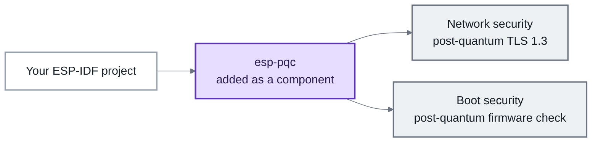
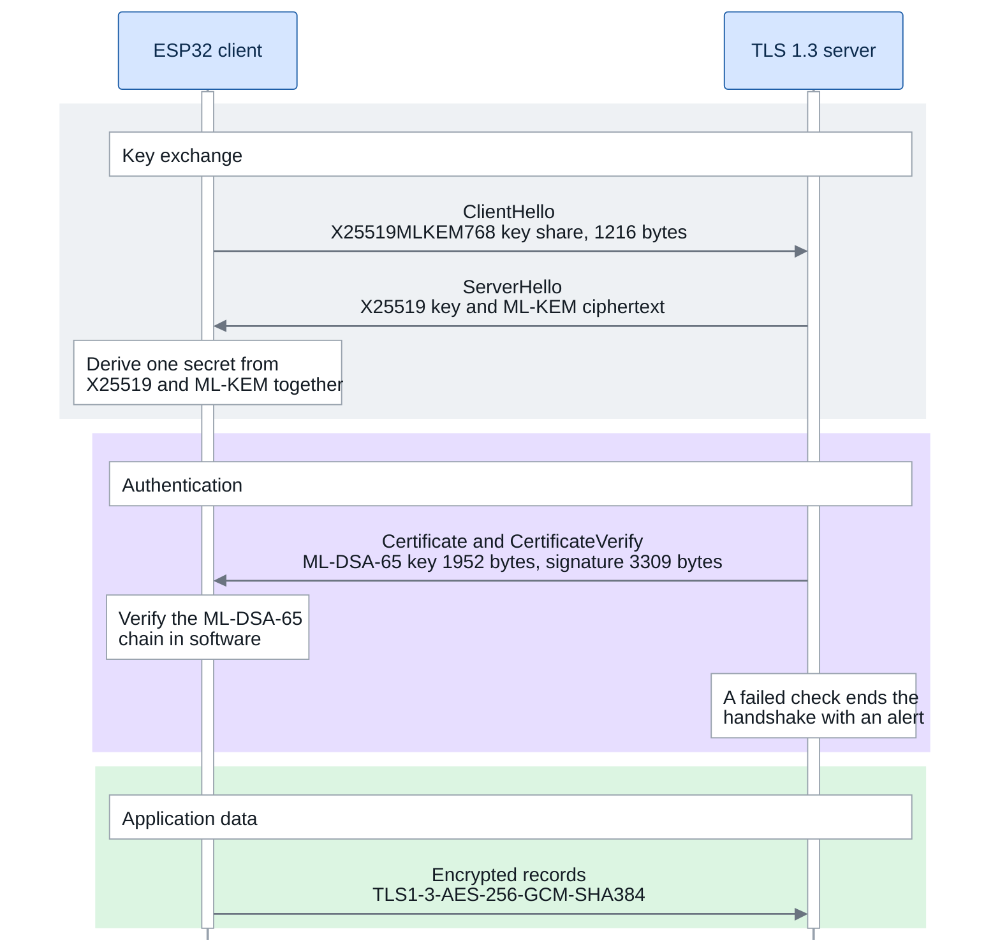
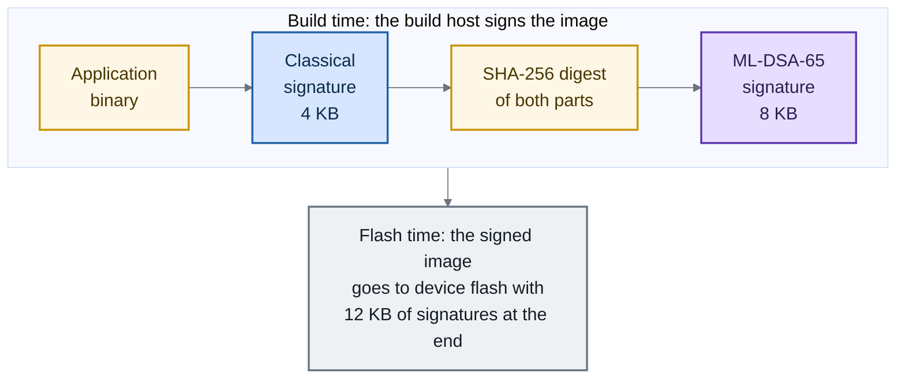
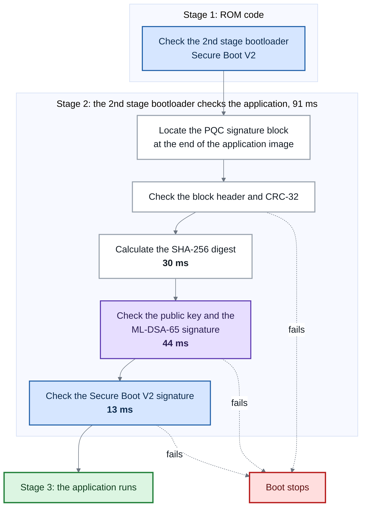

## Introduction

Consider an ESP32-powered smart electricity meter or industrial sensor gateway. It relies on TLS to securely transmit readings to the cloud and on digital signatures to ensure over-the-air (OTA) firmware updates are authentic and untampered. Today, these operations depend on classical public-key cryptography — primarily RSA and Elliptic Curve Cryptography (ECC).

However, future quantum computers will be capable of breaking both RSA and ECC using [Shor's algorithm](https://postquantum.com/quantum-security-reference/what-is-shors-algorithm/). This creates two critical vulnerabilities for long-lifecycle devices:
1. **Network Eavesdropping (TLS)**: Under **"Harvest Now, Decrypt Later" (HNDL)** attacks, adversaries can intercept and archive encrypted telemetry today, waiting to decrypt sensitive communications once quantum hardware matures.
2. **Remote Device Takeover (Secure Boot)**: By deriving the vendor's private signing key offline, an attacker could forge legitimate-looking firmware signatures and push malicious OTA updates to compromise devices in the field.

Because smart meters, automotive modules, and industrial devices routinely remain deployed for 10 to 15 years, their security architectures must be designed to withstand both post-quantum threats.

Following NIST's 2024 standardization of two foundational post-quantum algorithms:
- **ML-KEM** ([FIPS 203](https://csrc.nist.gov/pubs/fips/203/final)): A **Key Encapsulation Mechanism** used to establish shared symmetric encryption keys for secure communication channels (such as TLS 1.3).
- **ML-DSA** ([FIPS 204](https://csrc.nist.gov/pubs/fips/204/final)): A **Digital Signature Algorithm** used to authenticate identities and verify that firmware images and messages are authentic and untampered (such as Secure Boot).

Espressif introduced [**esp-pqc**](https://github.com/espressif/esp-pqc) using underlying [liboqs](https://github.com/open-quantum-safe/liboqs) for PQC implementation. This component provides a pure-software post-quantum cryptography solution, allowing developers to evaluate hybrid TLS 1.3 and hybrid Secure Boot V2 on existing Espressif SoCs today without waiting for next-generation hardware.

> [!NOTE]
> The `esp-pqc` component provides a software-based post-quantum cryptography solution designed for evaluation and benchmarking on current ESP32 SoCs.

## esp-pqc Component Overview

`esp-pqc` is a component that you add to an ESP-IDF project. It does not change any core framework file. It adds two primary capabilities to ESP-IDF projects: post-quantum network security via hybrid TLS 1.3, and post-quantum firmware integrity verification during boot.



<p class="text-center"><em>esp-pqc integration overview</em></p>

It includes an Espressif fork of [liboqs](https://github.com/open-quantum-safe/liboqs) for the post-quantum algorithms and an [mbedTLS](https://github.com/Mbed-TLS/mbedtls) override for post-quantum TLS 1.3.

| Component | Role & Functionality |
| --- | --- |
| [liboqs fork](https://github.com/espressif/esp-pqc/blob/main/components/liboqs/README.md) | Provides the underlying post-quantum algorithms, including ML-KEM-768 and ML-DSA-65, for Espressif chips. |
| mbedTLS override | A customized build of [mbedTLS](https://github.com/Mbed-TLS/mbedtls) that natively supports TLS 1.3 with hybrid key exchange groups and post-quantum certificates. |
| Bootloader verification | A small, verify-only ML-DSA-65 build for the 2nd stage bootloader, shown in [pqc_boot_verify](https://github.com/espressif/esp-pqc/blob/main/examples/pqc_boot_verify/README.md). |

`esp-pqc` also includes four examples and on-device Unity tests. See the [README](https://github.com/espressif/esp-pqc/blob/main/README.md) for setup.

### Requirements

The component requires **ESP-IDF v6.0 or later** and supports all Espressif SoCs. TLS examples need Wi-Fi and 4 MB of flash. Bootloader verification supports ESP32-C3, ESP32-C5, and ESP32-C6.

### Example Projects

`esp-pqc` includes four example projects. Each logs time, CPU cycles, heap use, and stack use on the serial monitor.

| Example | Purpose |
| --- | --- |
| <span style="white-space:nowrap">[kem_basic](https://github.com/espressif/esp-pqc/blob/main/examples/kem_basic/README.md)</span> | Measures ML-KEM-768 key-pair generation, encapsulation, and decapsulation performance. |
| <span style="white-space:nowrap">[signature_basic](https://github.com/espressif/esp-pqc/blob/main/examples/signature_basic/README.md)</span> | Measures ML-DSA signing and verification alongside RSA and ECDSA. |
| <span style="white-space:nowrap">[esp_hybrid_tls](https://github.com/espressif/esp-pqc/blob/main/examples/esp_hybrid_tls/README.md)</span> | Demonstrates TLS 1.3 with hybrid key exchange and post-quantum certificates. |
| <span style="white-space:nowrap">[pqc_boot_verify](https://github.com/espressif/esp-pqc/blob/main/examples/pqc_boot_verify/README.md)</span> | Verifies a post-quantum signature before Secure Boot V2. |


## Hybrid Cryptography Rationale

TLS 1.3 and Secure Boot use a hybrid approach that adds post-quantum protection without replacing existing security.

A hybrid approach operates like a dual-lock mechanism, combining proven classical algorithms with post-quantum schemes to deliver three core benefits:

1. **Dual-Layer Security**: An adversary must compromise both classical and post-quantum algorithms to breach the system.
2. **Retained Compliance**: Devices maintain their existing, hardware-accelerated algorithms (RSA or ECDSA) and adhere to current standards.
3. **Frictionless Evaluation**: Teams can measure real-world performance and memory overhead without overhauling existing security architectures.

## Hybrid TLS 1.3

`esp-pqc` adds `X25519MLKEM768` hybrid key exchange and `ML-DSA-65` certificates to mbedTLS.

mbedTLS manages algorithm negotiation, so applications can keep their standard TLS workflow. The [esp_hybrid_tls](https://github.com/espressif/esp-pqc/blob/main/examples/esp_hybrid_tls/README.md) example shows this integration.

### TLS Handshake Components

A TLS handshake relies on public-key cryptography for two distinct security functions:

1. **Key Exchange (Confidentiality)**: Generates shared encryption keys for application data. Under HNDL threats, recorded traffic can be decrypted later if classical keys are broken. `X25519MLKEM768` combines classical X25519 with post-quantum ML-KEM-768, requiring an adversary to compromise both schemes to recover the session key.
2. **Authentication (Identity Verification)**: Verifies the server's identity using digital certificates to protect against active man-in-the-middle attacks during the live handshake. The implementation supports both classical and post-quantum (ML-DSA-65) certificates.

The [esp_hybrid_tls](https://github.com/espressif/esp-pqc/blob/main/examples/esp_hybrid_tls/README.md) example uses `X25519MLKEM768` for the key exchange and an ML-DSA-65 certificate chain, so both jobs get post-quantum protection. The example README covers the other combinations it can build and the test-server setup.

### TLS Protocol Data

Post-quantum public keys, ciphertexts, and signatures are larger than classical ones.



<p class="text-center"><em>TLS client-server handshake</em></p>

| Item | Classical Size | Post-Quantum or Hybrid Size |
| --- | ---: | ---: |
| Key share | X25519: 32 bytes | X25519MLKEM768: 1,216 bytes |
| Public key | ECDSA-P256: ~64 bytes | ML-DSA-65: 1,952 bytes |
| Signature | ECDSA-P256: ~64 bytes | ML-DSA-65: 3,309 bytes |
| Peer key in the example test | — | 15,616 bits |
| CA certificate in the example test | — | 7,571 bytes |

Larger packets matter on metered, low-bandwidth, or frequently connected networks. Furthermore, because public keys (~1.9 KB) and certificate chains (~7.5 KB) are substantially larger than classical keys, applications must configure larger TLS I/O buffers in mbedTLS. Developers evaluating post-quantum TLS should account for this additional SRAM allocation when planning their system memory budgets.

### TLS Performance and Resource Use

The example logs memory use, connection time, and the negotiated cipher suite.

On an **ESP32-C5**, this handshake negotiates `TLS1-3-AES-256-GCM-SHA384` and completes in approximately 300 ms, including local network round trips.

Actual handshake latency depends on network round-trip time, packet loss, and certificate-chain depth.

## Post-Quantum Secure Boot

Secure Boot V2 checks the bootloader at every reset. The bootloader then checks the application firmware before it runs.

Because the on-chip Mask ROM exclusively supports classical Secure Boot V2 (RSA/ECDSA), post-quantum verification is introduced in the mutable 2nd-stage bootloader in software. The [pqc_boot_verify](https://github.com/espressif/esp-pqc/blob/main/examples/pqc_boot_verify/README.md) example demonstrates this hybrid boot flow: ROM executes its standard hardware-accelerated classical check on the 2nd-stage bootloader, and the bootloader then validates both the ML-DSA-65 and classical Secure Boot V2 signatures before handing control to the application.

> [!NOTE]
> The `pqc_boot_verify` example is designed for evaluation and benchmarking, enabling developers to measure the boot latency, flash overhead, and memory consumption of post-quantum verification within their boot flow.

### Classical Signature Scheme Support

The post-quantum layer works with either RSA-PSS-3072 or ECDSA. It wraps around the 4 KB classical signature sector.

Support depends on the target and silicon revision. See the [pqc_boot_verify README](https://github.com/espressif/esp-pqc/blob/main/examples/pqc_boot_verify/README.md#choosing-the-classical-scheme) and [ESP-IDF Secure Boot V2 documentation](https://docs.espressif.com/projects/esp-idf/en/latest/esp32c5/security/secure-boot-v2.html).

The benchmarks presented below use RSA-3072 as the classical partner.

> [!TIP]
> In this hybrid architecture, ML-DSA signature verification executes in software on the CPU, while SHA-256 hashing and classical signature verification (RSA/ECDSA) continue to leverage the ESP32's dedicated on-chip hardware accelerators.

### Firmware Image Signing

Signing happens on the build host, before the image reaches the device. The build system signs the binary twice.
1. It signs the application binary with the classical Secure Boot V2 scheme, appending a 4 KB signature sector.
2. It computes a SHA-256 digest across the entire application binary combined with that 4 KB classical signature sector.
3. It signs this combined digest using the ML-DSA-65 private key, appending an 8 KB post-quantum signature block.



<p class="text-center"><em>Firmware signing flow</em></p>

Hashing the firmware and classical signature block together binds both signatures. Changing either invalidates the post-quantum signature. Both blocks are at the end of the image.

| Memory Region | Size | Purpose |
| --- | --- | --- |
| Secure Boot V2 signature sector | 4 KB | Classical RSA-3072 or ECDSA signature. |
| PQC signature block | 8 KB | Post-quantum ML-DSA-65 signature, public key, digest, and header. |
| **Total signature footprint** | **12 KB** | Appended to the end of the firmware binary. |

The example build process automates signing.

### Bootloader Image Verification

Verification happens on the device at every boot. The ROM code checks the 2nd stage bootloader first. The 2nd stage bootloader then locates the PQC signature block at the end of the application image. It checks simple items first and stops when any check fails.



<p class="text-center"><em>Firmware verification flow</em></p>

The 2nd stage bootloader executes the following verification sequence:
1. **Locate PQC Block**: Finds the PQC signature block appended to the application image.
2. **Header & CRC-32 Check**: Validates the block header and CRC-32 checksum.
3. **Digest Calculation**: Computes the SHA-256 digest across the binary and classical signature sector (~30 ms).
4. **Public Key Validation**: Compares the public key stored in flash against the trusted key embedded in the bootloader.
5. **ML-DSA-65 Verification**: Verifies the post-quantum signature in software (~44 ms).
6. **Secure Boot V2 Verification**: Validates the classical RSA/ECDSA signature using hardware acceleration (~13 ms).

The flash key must match the trusted bootloader key. Otherwise, an attacker could use their own key to sign malicious code. Changing the trusted key requires updating and reflashing the bootloader.

> [!NOTE]
> The ML-DSA private key is as important as the Secure Boot V2 private key. Keep it secure. A lost or compromised key prevents trusted firmware updates.

### Secure Boot Performance and Resource Use

The following numbers were measured on an **ESP32-C5 running at 80 MHz** with RSA-3072 as the classical scheme.

| Verification Step | Execution Time | CPU Cycles | Acceleration Method |
| --- | --- | --- | --- |
| SHA-256 over image + classical sector | ~30 ms | 2,465,694 | Hardware (SHA accelerator) |
| ML-DSA-65 verify in software | ~44 ms | 3,533,980 | Software (CPU) |
| RSA-PSS-3072 verify in hardware | ~13 ms | 1,095,604 | Hardware (RSA accelerator) |
| **Total hybrid boot verification** | **~91 ms** | **7,328,597** | **Hybrid (Hardware + Software)** |

Post-quantum verification adds only ~78 ms to boot time and 8 KB of flash overhead, making it practical to evaluate on devices within standard SRAM budgets.

ML-DSA-65 verification takes about 22 ms in the [signature_basic](https://github.com/espressif/esp-pqc/blob/main/examples/signature_basic/README.md) FreeRTOS example and about 44 ms in the bootloader.

## Local Evaluation

Clone the repository, select an example project, and build, flash, and monitor it with the following commands:

```bash
git clone --recursive https://github.com/espressif/esp-pqc.git
cd esp-pqc/examples/kem_basic
idf.py set-target esp32c5
idf.py build flash monitor
```

Replace `kem_basic` with the example that you want to evaluate. For setup and board-specific integration instructions, refer to the relevant [esp-pqc example project README](https://github.com/espressif/esp-pqc/tree/main/examples).

## Additional Resources

While this article provides an architectural overview and performance context, each example and submodule in the repository includes detailed guides for deep dives.

| Document | Key Topics Covered |
| --- | --- |
| [esp-pqc README](https://github.com/espressif/esp-pqc/blob/main/README.md) | Component architecture, adding `esp-pqc` as a dependency to your own project, supported SoC list, and security guidelines. |
| [liboqs fork README](https://github.com/espressif/esp-pqc/blob/main/components/liboqs/README.md) | Algorithm catalogue, memory behavior, and Xtensa/RISC-V optimizations. |
| [esp_hybrid_tls README](https://github.com/espressif/esp-pqc/blob/main/examples/esp_hybrid_tls/README.md) | TLS profiles, test-server setup, certificate generation, and connection troubleshooting. |
| [pqc_boot_verify README](https://github.com/espressif/esp-pqc/blob/main/examples/pqc_boot_verify/README.md) | Bootloader verification setup, key generation, memory allocation details, and signing workflow. |
| [kem_basic](https://github.com/espressif/esp-pqc/blob/main/examples/kem_basic/README.md) & [signature_basic](https://github.com/espressif/esp-pqc/blob/main/examples/signature_basic/README.md) READMEs | Benchmarking individual KEM and digital signature algorithms, interpreting real-time cycle/memory telemetry, and testing alternate algorithms. |
| [ESP-IDF Secure Boot V2 Guide](https://docs.espressif.com/projects/esp-idf/en/latest/esp32c5/security/secure-boot-v2.html) | Foundational reference for classical Secure Boot V2, including chip-specific schemes, signature block structures, eFuse burning, and key revocation procedures. |

## Wrapping Up

This article explored how `esp-pqc` brings post-quantum cryptography to ESP-IDF as an accessible software solution. By focusing on the [esp_hybrid_tls](https://github.com/espressif/esp-pqc/blob/main/examples/esp_hybrid_tls/README.md) example for network security and the [pqc_boot_verify](https://github.com/espressif/esp-pqc/blob/main/examples/pqc_boot_verify/README.md) example for boot verification, developers can evaluate quantum-safe defenses today while maintaining trusted, hardware-accelerated classical protections.

Every project includes built-in telemetry to log execution time, CPU cycles, and memory usage directly to the serial monitor. Head over to the [esp-pqc repository](https://github.com/espressif/esp-pqc) to start evaluating post-quantum cryptography on your ESP32 hardware.

---

While `esp-pqc` enables developers to evaluate quantum-safe protocols in software on current devices today, future Espressif SoCs will integrate dedicated post-quantum hardware acceleration and feature built-in PQC secure boot verification workflows!
