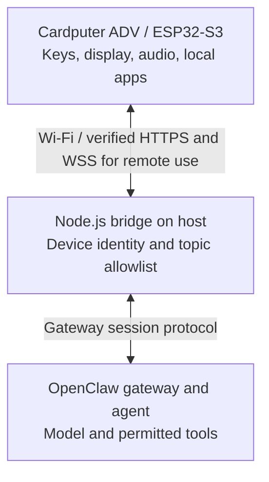

> Author disclosure: I maintain S1-ADV. This article was prepared with AI assistance and checked against the public project documentation. It describes an experimental implementation, with no claim of an independent security audit or a completed fresh-device installation test.

The featured photograph is an actual camera frame from the S1-ADV film, supplied by the project maintainer. It is separate from the film's explanatory animation.

A small keyboard, a microphone and a screen make a useful interface to an agent. They do not make the microcontroller the right place to run every part of that agent. In S1-ADV, the Cardputer ADV remains a device with local tools, while an OpenClaw installation on a computer or server supplies the agent.

The interesting engineering question is where those responsibilities meet. This article follows that boundary rather than treating a successful demonstration as evidence that every installation path is finished.

## Keep local tools local

The Cardputer ADV contains an ESP32-S3 with 8 MB flash. Its firmware uses Arduino/FreeRTOS. The device handles the keyboard, display, recording and playback, local applications and applying firmware updates. Settings live in NVS; optional media lives on microSD.

A calculator or local game does not need to become a model request. The project separates those local interactions from its connected conversation. This also makes it possible to describe a feature accurately: the handheld runs the interface and local software; the language model runs elsewhere. This is not a Linux distribution or on-device LLM implementation.

## Put the adapter on the host

A Node.js bridge translates the handheld's HTTP and WebSocket traffic into the configured OpenClaw gateway's session protocol. This is the place where the two interfaces are adapted, rather than making the microcontroller carry gateway credentials and a changing upstream protocol.

This diagram is a software responsibility map, not an electrical wiring schematic. It does not imply that the model or build tools execute on the ESP32-S3.

## Treat device identity and conversation routing separately

Each bridge instance authenticates one device identity with its own token. A topic allowlist constrains the conversations exposed to that device, and a topic key maps to an agent session. Independent devices require separate bridge instances and private storage; a single shared directory is not the documented multi-device deployment model.

The device receives a constrained bridge token. The gateway token and persistent gateway device identity remain on the host. Reply audio also checks the current topic and session owner. These controls explain the implementation's intended boundaries; they are not a claim that a complete independent security audit has taken place.

For a remote device, the documented transport uses verified HTTPS/WSS through a TLS reverse proxy. The firmware's default trust root is ISRG Root X1. A different certificate chain requires an intentional CA-bundle change and a new build. Disabling certificate checks is not an installation shortcut proposed by this article.

## Separate a conversation from permission to build firmware

The basic public setup starts with text chat. Voice adds host-side speech services and configuration. A separately configured development workflow can involve code, a build, review and a device update, but that is an additional permission boundary.

Firmware automation is off by default. Enabling an agent to answer a question should not implicitly give it every action available in a development environment. The handheld is not an autonomous self-reflashing computer: build tools and any permitted automation remain host-side, and the documented authenticated firmware endpoints provide the update path to the device.

A useful way to explain the film is therefore as a demonstration of a provisioned project, including chess and a focus-timer/lamp example. It does not establish that an arbitrary fresh device can reproduce every part without further setup.



The film combines real footage and animation. Actual device photographs are available on the [project page](https://www.hackster.io/sseregas/s1-adv-a-personal-environment-for-cardputer-adv-3a6f71); explanatory graphics should remain identified as illustrations.

## Preserve a clear installation and validation boundary

The documented starting point is a Cardputer ADV, a USB data cable, 2.4 GHz Wi-Fi, Python 3 and PlatformIO for the first flash, and an existing OpenClaw host. The standalone bridge requires Node.js 22 or later. Voice also needs FFmpeg and configured speech backends.

As of the source snapshot used for this article, the public builds have not yet been tested on a freshly provisioned physical device. Other Cardputer models are untested. Readers should use the current [getting-started guide](https://github.com/s1z0v/s1-adv/blob/main/docs/GETTING-STARTED.md), [flashing guide](https://github.com/s1z0v/s1-adv/blob/main/docs/FLASHING.md) and [validation notes](https://github.com/s1z0v/s1-adv/blob/main/docs/VALIDATION.md), and distinguish a successful build, a synthetic bridge test and physical-device validation.

Private provisioned binaries can contain Wi-Fi credentials and device tokens. They are excluded from the public distribution. Configuration, recordings and conversation logs do not belong in article attachments or public bug reports.

## Credit the foundation and read component licenses

S1-ADV grew from OmniBot by Naz Louis and its contributors. That origin remains in the project credits. The original MIT source notices are retained, and the bridge/plugin is separate from the firmware distribution. Firmware linked with libmeshtastic-leaf is distributed under GPL-3.0-only; other dependencies keep their respective notices. A single MIT label does not describe every distributed component.

The [repository](https://github.com/s1z0v/s1-adv), [architecture](https://github.com/s1z0v/s1-adv/blob/main/docs/ARCHITECTURE.md), [security model](https://github.com/s1z0v/s1-adv/blob/main/SECURITY.md), [credits](https://github.com/s1z0v/s1-adv/blob/main/CREDITS.md) and [firmware licensing notes](https://github.com/s1z0v/s1-adv/blob/main/docs/MESH.md#source-and-licensing) are the primary references for this project report.
