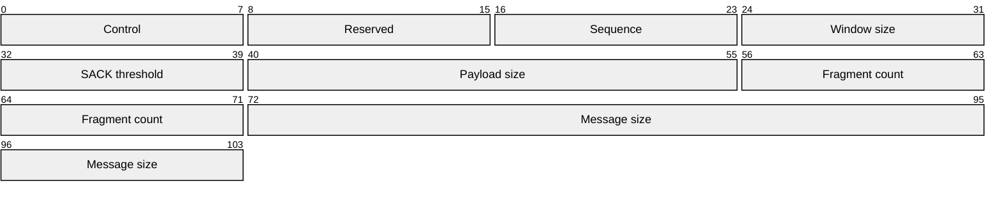
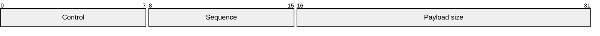
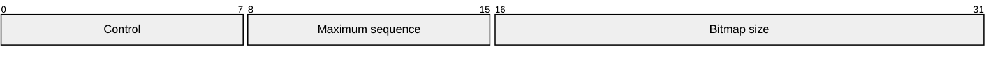
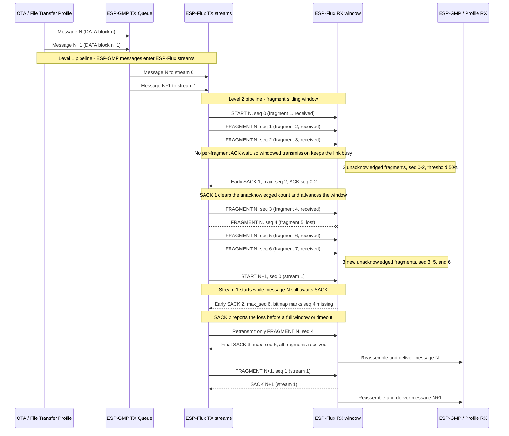
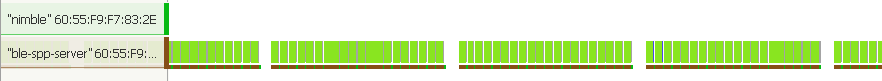

Embedded products regularly need to transfer data that is much larger than the payload of a single GATT operation. Common examples include OTA firmware images, files, diagnostic logs, resource bundles, and configuration data. These transfers may take place during commissioning, field maintenance, recovery, or direct service from a phone or another nearby tool.

Bluetooth Low Energy (BLE) is not always the best choice for bulk data transfer. When both peers support Wi-Fi, network access is available, and maximum throughput is the main requirement, Wi-Fi is generally more appropriate. BLE remains important when a device has no Wi-Fi, has not yet been provisioned onto a network, must minimize energy consumption, or needs a direct connection to a phone or service tool without network infrastructure. This article focuses on those BLE-dependent scenarios.

Transferring large data blocks reliably and quickly over the BLE Generic Attribute Profile (GATT) requires more than calling a single send function. An application must handle the per-operation limit imposed by the maximum transmission unit (MTU), fragmentation, reassembly, flow control, packet-loss recovery, disconnects, and buffer lifetimes. In a stop-and-wait design that sends one fragment and waits for its acknowledgment before sending the next, the link remains idle during every acknowledgment round trip. Any lost fragment further reduces payload goodput, the rate of application payload successfully delivered, through retransmission.

At the application level, the system must also define how requests and responses are matched, how commands are grouped, how errors are returned, and how services such as OTA and file transfer share the same link.

To build a reliable, high-throughput BLE data channel, Espressif created [esp_flux](https://github.com/espressif/esp-iot-solution/tree/master/components/esp_flux) and [esp_gmp](https://github.com/espressif/esp-iot-solution/tree/master/components/esp_gmp):

- **ESP-Flux** provides a reliable, high-throughput message channel over MTU-constrained links. Windowed transmission and selective acknowledgment (SACK) reduce idle time and avoid resending data that has already arrived.
- **ESP-GMP (ESP General Management Protocol)** defines device-management semantics on top of complete messages and provides profiles for OS capability queries, OTA, and file transfer.

The rest of this article first explains the boundary between the two components, with particular emphasis on the throughput mechanisms in ESP-Flux. It then uses BLE as the underlying transport to demonstrate the ESP-Flux SPP-like and ESP-GMP OTA examples, before discussing how to convert link-level improvements into end-to-end OTA and file-transfer performance.

## How the Components Divide Responsibilities

ESP-Flux and the ESP-GMP Core separate transport reliability and common management messaging from application-specific profile logic at different boundaries.

Within the BLE protocol stack, the physical layer (PHY) and Link Layer provide radio transmission and link control, the Logical Link Control and Adaptation Protocol (L2CAP) carries Attribute Protocol (ATT) traffic, and GATT exposes services, characteristics, and attribute operations. ESP-Flux runs above GATT to provide reliable complete-message delivery, while ESP-GMP and its profiles provide device-management semantics to the application.

```mermaid
flowchart LR
    APP["1 · Application / Profile<br/>OTA · File Transfer · Custom"]
    GMP["2 · ESP-GMP<br/>Frame · Route · Match responses"]
    ADAPTER["3 · Adapter<br/>ESP-GMP ↔ ESP-Flux"]
    FLUX["4 · ESP-Flux<br/>Fragment · Window · SACK"]
    BLE["5 · BLE GATT<br/>Write · Notify"]

    APP -->|Command / data| GMP
    GMP -->|ESP-GMP frame| ADAPTER
    ADAPTER -->|Complete message| FLUX
    FLUX -->|ESP-Flux packets| BLE

    classDef application fill:#ffffff,stroke:#60758a,stroke-width:1.5px,color:#243746;
    classDef gmp fill:#fff1ee,stroke:#e7352c,stroke-width:2px,color:#243746;
    classDef adapter fill:#f4f6f8,stroke:#718096,stroke-width:1.5px,color:#243746;
    classDef flux fill:#edf7ff,stroke:#1676b8,stroke-width:2px,color:#243746;
    classDef transport fill:#ffffff,stroke:#60758a,stroke-width:1.5px,color:#243746;

    class APP application;
    class GMP gmp;
    class ADAPTER adapter;
    class FLUX flux;
    class BLE transport;
```



The arrows show the transmit direction. On receive, the same five stages are traversed in reverse: BLE packets are reassembled into an ESP-Flux message, decoded and routed by ESP-GMP, and finally delivered to the target profile.

| Component | Responsibilities | Out of scope |
| --- | --- | --- |
| `ble_conn_mgr` | Scanning, advertising, connection establishment, and GATT service registration and discovery | Reliable large-message transfer and management commands |
| ESP-Flux | Fragmentation and reassembly, SACK, sliding windows, timeout retransmission, and multiple streams | Connection management, command semantics, and OTA state machines |
| ESP-GMP | Common framing, request/response dispatch, sequence numbers, status codes, and the transmit (TX) queue | Protocol-level fragmentation, general-purpose serialization, and authentication |
| ESP-GMP Profile | Business state machines for OTA, file transfer, capability queries, and other services | BLE connection handling and ESP-Flux fragmentation details |

This separation provides two immediate benefits:

1. A profile does not need to know whether its data ultimately travels over BLE, UART, or another medium. As long as a new transport implements `esp_gmp_transport_t`, the ESP-GMP Core and application logic can be reused.
2. ESP-Flux does not need to know whether a payload contains firmware, a file, or a custom command. It ensures that a complete message arrives reliably and then delivers it to the upper-level protocol through a callback.

## ESP-Flux: A Reliable Message Channel over Small Packets

In the BLE scenario discussed here, ESP-Flux provides a **reliable message channel** between GATT and the upper-level protocol. BLE GATT can carry only a small amount of data per operation because of the ATT MTU, while an OTA firmware block, file block, or management message is often much larger than a single GATT packet. ESP-Flux accepts a complete message, divides it into packets that fit over GATT, and reconstructs the original message at the receiver.

A message passes through ESP-Flux as follows:

1. ESP-Flux calculates the payload capacity of each fragment from the current MTU.
2. It assigns a `stream_id` and creates the first and subsequent data fragments.
3. It sends multiple fragments continuously within a sliding window, without waiting for an acknowledgment after every fragment.
4. The receiver uses SACK messages to report received and missing fragments.
5. The sender retransmits only missing fragments. After all fragments are acknowledged, the receiver delivers one complete message to the calling protocol.

ESP-Flux handles reliable delivery and flow control. It does not handle BLE scanning, advertising, connection establishment, or GATT service discovery, and it does not parse application payloads. The BLE connection-management component manages the connection, while ESP-GMP and its profiles provide OTA, file-transfer, and device-management semantics.

### ESP-Flux Packet Types

Every ESP-Flux packet begins with a one-byte control field containing the protocol version, `stream_id`, and packet type. The reliable transfer path primarily uses three packet types:

- `START`: The first fragment of a message. It carries transfer metadata such as the total length, total fragment count, window size, and acknowledgment threshold. Even if a complete message fits into one packet, it still uses `START` and follows the same acknowledgment path.
- `FRAGMENT`: A subsequent data fragment. Its sequence number identifies its position within the original message.
- `SACK`: A selective acknowledgment returned by the receiver. It confirms received fragments and uses a bitmap to identify missing ones.

The protocol also defines a `SINGLE` packet type, and the receive path can parse it. The current public `flux_session_send()` path does not transmit `SINGLE`; even a one-fragment message uses `START` so it follows the same acknowledgment and retransmission state machine.

When the data fits within the payload capacity of the first fragment, the transfer consists of one `START` followed by an acknowledgment. Larger transfers consist of one `START`, multiple `FRAGMENT` packets, and one or more SACKs.

The following diagrams show the headers used by that path. Bit offsets start at the first byte of the ESP-Flux packet; a variable-length payload follows each header. In the control byte, the packet type occupies 3 bits, `stream_id` occupies 3 bits, and the protocol version occupies 2 bits.

**START header (13 bytes)**



**FRAGMENT header (4 bytes)**



**SACK header (4 bytes)**



For `START` and `FRAGMENT`, the payload contains message data. For `SACK`, the optional payload is a 16-byte bitmap in which a set bit marks a missing fragment. Keeping the bitmap out of the fixed header allows a cumulative acknowledgment with no missing fragments to remain only four bytes long.

In BLE GATT, ATT itself consumes three bytes. An ESP-Flux `FRAGMENT` header consumes another four bytes, so the maximum application payload in each subsequent fragment is:

```text
MTU - 3 (ATT) - 4 (ESP-Flux) = MTU - 7
```

The `START` header is 13 bytes, making the first-fragment payload limit `MTU - 16`. The current defaults allow up to 128 fragments and a reassembled message of up to 64 KiB. The actual maximum message size is jointly constrained by the current MTU and the fragment-count limit.

### How ESP-Flux Improves Payload Goodput

ESP-Flux does not increase the nominal BLE PHY rate. It improves the **payload goodput** ultimately observed by the application. It keeps data flowing over the link and retransmits only missing fragments.

The following table isolates the two factors that most directly affect goodput: **whether the sender leaves the link idle while waiting for acknowledgments**, and **how much data must be resent after a fragment is lost**. The three strategies assume the same BLE PHY, MTU, connection interval, and application payload; only their scheduling and acknowledgment mechanisms differ. This is therefore a comparison of mechanisms, not an absolute benchmark or performance ranking. Stop-and-wait and fixed-batch transfer are reference models used to illustrate the differences, not selectable ESP-Flux modes.

| Transfer strategy | Sending pattern | Loss recovery | Effect on payload goodput |
| --- | --- | --- | --- |
| Per-fragment stop-and-wait | Wait for an acknowledgment after every fragment | Usually retransmit after a timeout | The link can remain idle during each acknowledgment round trip |
| Fixed batches without selective acknowledgment | Send a complete batch continuously | May retransmit the full batch or entire message | Fast on a clean link, but expensive when a fragment is lost |
| ESP-Flux sliding window + SACK | Keep multiple fragments in flight within the window | Retransmit only fragments marked missing by the bitmap | Reduces both waiting time and unnecessary retransmission |

A sliding window amortizes acknowledgment latency across multiple fragments, while SACK limits recovery cost to the fragments that are actually missing. Sliding windows reduce link idle time, and SACK reduces redundant retransmissions. Together they increase goodput. The difference among strategies may narrow when the link is lossless, acknowledgment latency is negligible, and lower-level buffers are already saturated. ESP-Flux provides a clearer advantage for long transfers, nontrivial acknowledgment round trips, or links with occasional fragment loss.

ESP-Flux derives its throughput advantage from the following mechanisms:

1. **A sliding window keeps the link busy**: The sender does not wait for the previous fragment to be acknowledged before sending the next one. As long as the window has capacity, it can continue submitting fragments to the transport.
2. **SACK reduces the cost of loss**: A 16-byte bitmap can describe the receive state of up to 128 fragments. The sender retransmits only missing fragments instead of rewinding and repeating data that has already arrived.
3. **A window threshold triggers acknowledgments early**: The receiver can send a SACK as soon as window occupancy reaches a configured percentage, rather than always waiting for the window to fill or a retransmission timer to expire. A lower threshold speeds up feedback and recovery; a higher threshold reduces acknowledgment overhead.
4. **Fragment size follows the actual MTU**: Once the link MTU is established or changes, ESP-Flux adjusts the capacity of subsequent transfers to the available packet size. A larger MTU reduces both the number of fragments per message and the proportion of bytes consumed by ATT and ESP-Flux headers.
5. **Messages and fragments form a two-level pipeline**: By default, each session supports two concurrent send streams, and each stream can keep multiple fragments in flight. Combined with the ESP-GMP TX queue and the data-block pipelines in the OTA and File Transfer profiles, this allows the application to prepare later work without waiting for a large block to complete entirely.
6. **Sender-side backpressure prevents busy loops and cascading failures**: When the NimBLE memory-buffer (mbuf) pool available for transmission is constrained, the sender pauses submission and retries later instead of amplifying temporary congestion through uncontrolled sends.

The following timeline combines these mechanisms in one diagram. The example uses `window_size = 6` and `window_threshold = 50%`, and assumes that the first transmission of `seq 4` is lost after the first SACK:



In the diagram, the profile tracks multiple in-flight ESP-GMP requests and their responses in the application logic. The ESP-GMP TX queue provides bounded transmit buffering. When all ESP-Flux send streams are occupied, new messages wait in the queue. Once that queue is full, ESP-GMP propagates congestion back to the profile so it can stop submitting messages. When an existing transfer completes and frees capacity, the pipeline can be filled again.

Each ESP-GMP frame accepted by ESP-Flux occupies an ESP-Flux stream, and the sliding window within that stream keeps multiple fragments in flight. The current two-stream design primarily overlaps a previous message waiting for a SACK or retransmission with transmission of the next message.

A threshold-triggered SACK reports receive state before the window fills, allowing the sender to recover missing fragments and continue filling the link sooner. Lower thresholds provide earlier feedback and recovery but may generate more SACKs; higher thresholds reduce acknowledgment overhead but may delay new window capacity.

ESP-Flux is therefore particularly useful for large payloads, links with meaningful acknowledgment round-trip time, and links with occasional fragment loss. The tradeoff is that larger windows and concurrent streams require more tracking state, retained source buffers, and receive-side reassembly memory. A larger window is not always better; tune it incrementally against mbuf availability, heap usage, and application processing speed.

The over-the-air capture below shows an actual transfer. Data exchange occupies nearly all available airtime in each connection interval, making effective use of the airtime available under this test configuration.



### Session and Buffer Ownership

On the transmit path, ESP-Flux does not take ownership of the source buffer supplied by the application. If the send function returns `ESP_OK`, the application must keep that buffer valid until `session_complete_cb` reports the transfer's terminal state. If the send function returns an immediate error, the transfer was not accepted and no completion callback follows; the caller must release or reuse the buffer itself.

Direct ESP-Flux-session teardown reports accepted in-flight sends through `session_complete_cb` with an error status. The current GATT wrapper, however, removes the GATT session from its callback registry before destroying the underlying ESP-Flux session, so applications must not rely exclusively on destroy-time GATT callbacks for cleanup. A GATT application should track accepted source buffers, stop submitting data during link teardown, and reclaim any buffers that remain pending after teardown completes.

On the receive path, buffer ownership is reversed. After reassembly, ESP-Flux transfers ownership of the receive buffer to `data_received_cb`; the application must call `free()` after processing it.

```c {title="Receiving a Complete ESP-Flux Message"}
static void on_data_received(gatt_session_t *session, uint8_t stream_id,
                             const uint8_t *data, uint32_t size)
{
    // Process one fully reassembled message.
    process_message(data, size);

    // Ownership of the receive buffer has been transferred to the application.
    free((void *)data);
}
```

This ownership rule is critical. Releasing a transmit buffer too early can cause a use-after-free, corrupted data, or an invalid memory access, while failing to release receive buffers will eventually exhaust the heap during sustained transfers.

## ESP-GMP: Adding Device-Management Semantics to Reliable Messages

ESP-Flux handles packet fragmentation and reliable delivery; it does not parse application data. ESP-GMP adds a common device-management model so both peers know which command a message represents, which profile should receive it, and whether the requested operation ultimately succeeded.

```text
Profile command and application data
                 ↓
      ESP-GMP request / response
                 ↓
ESP-Flux reliable messaging and fragmentation
```

ESP-GMP provides three primary capabilities:

- **Command routing**: Every message identifies a functional group and a specific command. ESP-GMP first dispatches the message to the appropriate profile, which then interprets the application data.
- **Request/response correlation**: A request carries a sequence number, and its response echoes the same value. A profile can therefore maintain multiple in-flight requests and match responses back to the correct request even when they arrive at different times. The sequence number supplies the correlation key; the profile manages the table of in-flight requests, timeouts, and retries.
- **Consistent result reporting**: A response can report success, busy, invalid length, unsupported operation, and other statuses, allowing the application to distinguish "the transport completed" from "the business operation succeeded."

The currently defined standard groups are:

- `GRP_OS (0x00)`: Capability queries.
- `GRP_OTA (0x01)`: Firmware-upload control, data, and status queries.
- `GRP_FILE_TRANSFER (0x08)`: File metadata, data blocks, final confirmation, and cancellation.

ESP-GMP does not require profile data to use a general-purpose serialization format. In an embedded system, each profile can define a compact binary payload appropriate for its storage, bandwidth, and decoding constraints.

In short, ESP-GMP handles message format, routing, and command semantics, while ESP-Flux handles packet fragmentation, flow control, and reliable delivery. In the BLE implementation, a complete ESP-GMP message is sent as one ESP-Flux message, while ESP-Flux handles fragmentation, windows, SACK, retransmission, and reassembly.

## Binding ESP-GMP to ESP-Flux / GATT

After the BLE link is established, the characteristic handles are ready, and MTU negotiation is complete, the system creates a GATT / ESP-Flux session for that connection and associates it with an ESP-GMP link. The ESP-GMP / ESP-Flux Adapter connects the two components and maps ESP-GMP messages onto the ESP-Flux session.

```text
Transmit: Profile → ESP-GMP message / TX queue → ESP-Flux fragmentation and reliable transfer → GATT
Receive:  Profile ← ESP-GMP parsing and routing   ← ESP-Flux reassembly                       ← GATT
```

This binding preserves clear responsibility boundaries:

- A profile handles application operations such as OTA or file transfer, including response matching, without needing to know the GATT MTU or ESP-Flux fragmentation details.
- The ESP-GMP Core frames messages, carries sequence numbers, dispatches messages to profiles, and manages a bounded TX queue without directly manipulating BLE packets.
- ESP-Flux treats each ESP-GMP message as an opaque block of data. It handles fragmentation, windows, SACK, retransmission, and reassembly without interpreting the application command.

Connection lifecycle management is another important responsibility at this boundary. After a disconnect, the old session must stop accepting new messages. The link-down event should first be propagated to the profiles so they can terminate or clean up active transactions, after which the ESP-Flux / GATT session resources can be released. When the device reconnects, the complete data path is rebuilt using the new connection handle, characteristic handles, and MTU. Session destruction involving NimBLE should be performed safely in the NimBLE host-task context.

## Practice 1: Validate ESP-Flux with the BLE SPP-Like Examples

Before introducing ESP-GMP, use the ESP-Flux Serial Port Profile (SPP)-like BLE examples to validate the boards, BLE connection parameters, and reliable message channel. SPP is the example name; these are BLE GATT applications, not implementations of Bluetooth Classic SPP. The example consists of two projects:

- **SPP Server**: Runs as a Peripheral that advertises and provides the GATT service.
- **SPP Client**: Runs as a Central that scans, connects, and subscribes to notifications.

Follow the example READMEs to select a target, build, flash, and run each project:

- [BLE SPP Server instructions](https://github.com/espressif/esp-iot-solution/blob/master/examples/esp_flux/ble_spp_server/README.md)
- [BLE SPP Client instructions](https://github.com/espressif/esp-iot-solution/blob/master/examples/esp_flux/ble_spp_client/README.md)

After the connection is ready, the two peers continuously exchange test data larger than a typical single GATT packet. Verify that long messages are reassembled completely, the window continues to advance, and transfers recover normally after a disconnect and reconnect. The Server can also be tested with the [ESP BLE App](https://github.com/EspressifApps/esp-ble-app) on Android 12 or later.

If the transfer is unstable, first confirm the actual MTU, connection interval, PHY, and BLE Link Layer data length. Then check for an oversized window, exhausted NimBLE buffer resources, or insufficient application memory. This stage validates the ESP-Flux data path in isolation, making it easier to distinguish BLE transport problems from profile state-machine issues introduced later.

## Practice 2: Run an ESP-Flux-Based Profile with ESP-GMP OTA

The ESP-GMP OTA example adds capability negotiation, OTA control commands, a data pipeline, and SHA-256 integrity verification on top of reliable ESP-Flux messages:

- **Server (device being updated)**: Runs as a BLE Peripheral and writes the firmware directly to the next OTA partition.
- **Client (uploader)**: Runs as a BLE Central, reads `ota_image.bin` from SPIFFS, and uploads it.

For firmware-image preparation, partition configuration, build and flash instructions, and expected logs, see:

- [ESP-GMP OTA Server instructions](https://github.com/espressif/esp-iot-solution/blob/master/examples/esp_gmp/gmp_ota/ble_gmp_ota_server/README.md)
- [ESP-GMP OTA Client instructions](https://github.com/espressif/esp-iot-solution/blob/master/examples/esp_gmp/gmp_ota/ble_gmp_ota_client/README.md)

After the Client establishes the link, it proceeds through four stages:

1. **Capability negotiation**: Confirm the peer's OTA capabilities and available message size.
2. **Upgrade-session setup**: Validate image metadata and prepare the target OTA region.
3. **Pipelined data upload**: The Client continuously submits multiple firmware blocks, while the Server writes them to flash in the background and incrementally calculates SHA-256.
4. **Image completion and switch-over**: The Server drains pending writes, validates the length and hash, and selects the new boot partition.

This flow demonstrates the separation of responsibilities across the three components: ESP-Flux delivers complete messages, the ESP-GMP Core carries sequence numbers and dispatches messages, and the OTA Profile maintains the in-flight request table, matches responses, handles timeouts and retries, manages the upgrade session, executes flash writes, and verifies image integrity.

> [!IMPORTANT]
> SHA-256 detects transfer corruption here; it does not prove that the firmware came from a trusted source. The example also provides neither BLE access control nor ESP-GMP authentication. A production product should combine Secure Boot, signed application verification, Flash Encryption, and link authentication and business authorization appropriate to its threat model.

The current OTA upload always starts at image offset zero and does not support resuming an interrupted upload. After a disconnect, cancel the active session, reconnect, and upload the image again from the beginning.

## Extending from OTA to File Transfer and Custom Profiles

The ESP-GMP File Transfer Profile demonstrates how the same underlying stack can carry a different application service. It supports file-metadata negotiation, pipelined data blocks, cancellation, SHA-256 verification, safe staging through a temporary file, and final confirmation. The receiver reports final success only after the file has been written, its hash has been verified, and the result has been committed. Transport-level completion therefore does not indicate that the file has been stored reliably; final profile success provides that guarantee.

Two examples demonstrate bidirectional transfer. Their directory names indicate the default connection roles, not a restriction on file direction; after a connection is established, either peer can initiate a transfer. For configuration, build and flash instructions, and command usage, see:

- [File Transfer Sender instructions](https://github.com/espressif/esp-iot-solution/blob/master/examples/esp_file_transfer/sender_demo/README.md)
- [File Transfer Receiver instructions](https://github.com/espressif/esp-iot-solution/blob/master/examples/esp_file_transfer/receiver_demo/README.md)

Custom management capabilities can follow the same pattern:

1. Define a distinct functional group and commands, and give each application payload explicit version and length constraints.
2. Implement command handling and the application state machine in a profile, using sequence numbers to correlate requests and responses.
3. Handle disconnects, transport errors, timeouts, and cancellation so every transaction reaches an explicit terminal state.
4. Dynamically select the data-block size and number of in-flight requests according to current link capacity and TX-queue pressure.

## Turning ESP-Flux Improvements into End-to-End Throughput

ESP-Flux reduces link idle time and unnecessary retransmission, but increasing the BLE PHY, MTU, or ESP-Flux window does not necessarily increase OTA and file-transfer speed proportionally. End-to-end throughput also depends on the ESP-GMP TX queue, the profile pipeline, the time required to write flash or the file system at the receiver, and when the application response is sent. To preserve the gains from ESP-Flux, the application must avoid reintroducing stop-and-wait behavior on the hot path.

Tune the system in the following order:

1. **Verify the actual link parameters first**: Record the negotiated MTU, connection interval, PHY, and BLE Link Layer data length instead of relying only on configured expectations.
2. **Fit data blocks to the effective payload**: Calculate block size from runtime limits to avoid unnecessary extra ESP-GMP messages or ESP-Flux fragments.
3. **Tune the ESP-Flux window and SACK threshold incrementally**: Start with the default window size of 6. A larger window can cover more acknowledgment latency, but it also increases mbuf and heap pressure. Balance the threshold between acknowledgment frequency and loss-recovery latency.
4. **Verify that both pipeline levels are active**: Record the profile's in-flight block count, ESP-GMP `esp_gmp_tx_in_flight()`, and ESP-Flux stream and fragment progress together. If the application allows only one block in flight, it cannot fully use ESP-Flux concurrency.
5. **Observe application backpressure**: `ESP_ERR_ESP_GMP_TX_QUEUE_FULL` indicates temporary backpressure and can be retried after an in-flight frame completes. `ESP_ERR_INVALID_STATE` means that the link, transport, or component state is not currently usable; revalidate that state instead of retrying blindly. A persistently full queue means downstream processing cannot keep up; enlarging the window further will only consume more memory.
6. **Move slow storage operations out of the receive path**: The protocol task should validate and enqueue data into a bounded queue quickly, leaving a worker to write flash or the file system. Final success, however, must wait until all data has actually been written and its hash verified.
7. **Measure goodput, integrity, and resources together**: In addition to total bytes divided by elapsed time, record the fragment retransmission rate, SACK count, queue-full count, peak heap use, disconnect cleanup behavior, and final SHA-256. These measurements reveal whether an improvement came from the ESP-Flux window, link parameters, or changes to the storage path.

## Conclusion

ESP-Flux and ESP-GMP decouple transmission reliability from management protocol logic. ESP-Flux overlaps acknowledgment latency with later transmissions through its sliding window, limits loss recovery to genuinely missing data through SACK, and improves payload goodput through MTU-aware fragmentation, concurrent streams, and mbuf backpressure management. ESP-GMP organizes that reliable, high-throughput messaging capability into an extensible device-management channel.

Applications that only need to transfer arbitrary binary messages reliably can use ESP-Flux directly. Applications that also require request/response semantics, capability negotiation, status codes, OTA, file transfer, or custom management commands can add ESP-GMP over ESP-Flux or another transport. Understanding the boundary between the two components, buffer ownership, and disconnect sequencing is essential when moving from an example to a robust product.

## Resources

- [ESP-Flux component](https://github.com/espressif/esp-iot-solution/tree/master/components/esp_flux)
- [BLE SPP examples based on ESP-Flux](https://github.com/espressif/esp-iot-solution/tree/master/examples/esp_flux)
- [ESP-GMP component](https://github.com/espressif/esp-iot-solution/tree/master/components/esp_gmp)
- [ESP-GMP protocol specification](https://github.com/espressif/esp-iot-solution/blob/master/components/esp_gmp/SPEC.md)
- [ESP-GMP OTA examples](https://github.com/espressif/esp-iot-solution/tree/master/examples/esp_gmp/gmp_ota)
- [ESP-GMP File Transfer examples](https://github.com/espressif/esp-iot-solution/tree/master/examples/esp_file_transfer)
- [ESP BLE App](https://github.com/EspressifApps/esp-ble-app)
