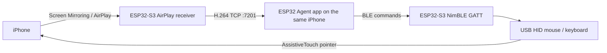

Most ways of letting software drive an iPhone still assume a computer: XCUITest, WebDriverAgent, or Apple's own iPhone Mirroring. They need a Mac, a signed helper, or a developer account, and the computer has to stay on for every task. The usual alternatives are a jailbreak or a cloud phone farm.

ESP32 iPhone Agent (Handsy) takes a different path. A Seeed Studio XIAO ESP32S3, about $7, plugs into the iPhone's USB-C port and does the computer's job: it sees the screen and moves a pointer. The phone stays a stock iPhone. There is no jailbreak, and nothing has to stay plugged into a Mac while a task runs.

The firmware lives in [`hardware/hid_bridge`](https://github.com/onehumanbeing/esp32-iphone-agent/tree/main/hardware/hid_bridge) of [onehumanbeing/esp32-iphone-agent](https://github.com/onehumanbeing/esp32-iphone-agent). It is written in Arduino-ESP32 and holds no agent logic; the iOS app, or a computer-side client talking to the same board, decides what to do. This article is about the firmware: how one ESP32-S3 becomes an AirPlay receiver, a USB HID device, and a BLE command link at the same time.



## The three jobs of one chip



The phone's Wi-Fi joins the board's soft AP, and the user picks Control Center → Screen Mirroring → *ESP32 Agent*, the name the board advertises. It receives the AirPlay session, keeps the H.264 access units, and forwards them to the app over Wi-Fi. It does not decode video. BLE carries commands and status. Native USB enumerates as a mouse, a keyboard, and a consumer-control device. With iOS AssistiveTouch on, a mouse click is a tap and a drag is a swipe.

The phone reaches the vision model over cellular data, since its Wi-Fi is joined to the board's hotspot.

The current firmware reports itself as `0.2.4` (`hardware/hid_bridge/version.h`). The tested board is the plain XIAO ESP32S3 with 8 MB PSRAM, not the Sense or Plus variants. Any ESP32-S3 with native USB on its USB-C port and PSRAM should work; the phone powers the board.

## USB HID: a relative mouse that has to be trusted

The ESP32-S3's USB device peripheral makes this practical. The firmware uses the Arduino-ESP32 USB stack and TinyUSB:

```cpp {title="hardware/hid_bridge/hid_bridge.ino"}
#include "USB.h"
#include "USBHIDMouse.h"
#include "USBHIDKeyboard.h"
#include "USBHIDConsumerControl.h"
#include "tusb.h"

USBHIDMouse mouse;
USBHIDKeyboard keyboard;
USBHIDConsumerControl consumer;
const uint16_t AC_HOME = 0x0223;  // HID consumer page: AC Home
```

In `setup()`, the firmware calls `mouse.begin()`, `keyboard.begin()`, `consumer.begin()`, then `USB.begin()`. From the iPhone's point of view this is a standard HID composite device, not a custom accessory protocol.

The command set is small and text-based. The board answers `ok` or `err <why>`:

| Command | What it does |
| --- | --- |
| `ping` | Liveness |
| `pace` | Returns the move-pacing version, so the app can recalibrate if it changed |
| `home` | Drives the pointer into the top-left corner |
| `move <dx> <dy> [speed]` | Relative move, paced into equal reports |
| `press` / `release` / `click` | Left button |
| `scroll <v> <h>` | Wheel |
| `type <text>` | Keyboard characters |
| `key <combo>` | Key combinations such as `cmd+h` or `enter` |
| `homescreen` | Consumer-control AC Home, which iOS treats like a keyboard Home key |

A locked or sleeping iPhone suspends USB. Sending HID reports in that state can stall the board, so every command except `ping` and `pace` first asks the host to wake up, and fails fast if it does not:

```cpp {title="hardware/hid_bridge/hid_bridge.ino"}
bool usbReady() {
  if (tud_suspended()) {
    tud_remote_wakeup();
    for (int i = 0; i < 50 && tud_suspended(); i++) delay(10);
  }
  return tud_mounted() && !tud_suspended();
}
```

If the phone is still suspended, the command returns `err phone usb asleep (unlock the phone)` instead of blocking inside a HID write. An 8-second task watchdog reboots the board if a loop does hang, for example on a blocked USB call.

### Why moves are paced

iOS accelerates the AssistiveTouch pointer according to the speed of each HID report. Early firmware capped X and Y separately, so a diagonal calibration move and a later axis-aligned move did not travel the same distance. The current pacer (`src/hid/pace.c`, `PACE_VERSION 3`) cuts a `move` into reports that all have the same vector. The default is 10 counts per report, every 8 ms. The app can pass a different per-report speed when it calibrates.

Re-homing is a hard shove into the corner: 25 reports of `(-127, 0)`, then 25 reports of `(0, -127)`. Horizontal first, then vertical, so the pointer travels up the left edge and does not ride the top edge from the right, which opened Control Center during testing.

None of this is absolute positioning. USB mice are relative. The iOS app keeps its own estimate of the pointer, re-homes periodically, and before a precise tap it wiggles the pointer, finds it in the mirrored frame, and corrects the miss. That loop lives in the app, not on the board.

### One driver at a time

The same HID endpoint can be driven by the iOS app over BLE, or by a computer-side CLI over BLE or TCP. An arbiter (`src/hid/arbiter.c`) makes sure only one side is in control. The app wins: while its link is up, the CLI is refused with `err busy: the app is using the board`. If a side disconnects while it is holding the mouse button, the firmware releases the button so the pointer is not left down.

## AirPlay: receive on the ESP32, decode on the iPhone

The AirPlay receiver is a port of [UxPlay](https://github.com/FDH2/UxPlay), which itself builds on RPiPlay. That part of the firmware is GPL-3.0 (`src/airplay/LICENSE-GPL.md`). The rest of the project is MIT.

`airplay_start()` advertises the receiver over mDNS and runs an RTSP server task. The configuration the rest of the firmware cares about is small:

```c {title="hardware/hid_bridge/src/airplay/airplay.h"}
typedef struct {
  const char *name;         // shown in Screen Mirroring
  uint8_t hwaddr[6];
  uint8_t ed25519_seed[32]; // long-term pairing identity, kept stable across boots
  uint16_t width, height;
  uint8_t max_fps;
  void (*on_config)(const uint8_t *sps_pps, size_t len);
  void (*on_au)(const uint8_t *au, size_t len, bool idr);
  void (*on_audio)(int event, const uint8_t *frame, size_t len, uint32_t ts);
  void (*log)(const char *msg);
} airplay_cfg;
```

Video comes out as Annex-B H.264 access units from the mirror task. The board does not run a decoder. It forwards those units to the app over the soft AP.

The production transport is TCP port 7201 (`WV_TCP 1` in `wifi_video.h`). The app opens one session at a time and authenticates with a per-boot token, delivered only to a bonded app over the encrypted BLE `net` characteristic. An earlier UDP path on port 7200, with NACK/resync, is still in the tree but is not the default. On a weak link its resyncs became storms that starved both mirroring and BLE.

AirPlay audio is forwarded the same way, as AAC-ELD frames, after the app opts in. The iOS app can turn that into text, which is how listening exercises work. Audio records share the TCP stream with video and use their own sequence numbers.

Screen Mirroring from macOS is not supported: the handshake can look healthy while the board never receives video. The documented mirror is 480×1040, at up to 5 fps. iOS will not mirror passcode entry, Apple Pay, or DRM video, and mirroring stops when the phone locks. Those limits are iOS's, not the board's.

## BLE is the command path

The iOS app talks to the board over a GATT link implemented with h2zero's NimBLE-Arduino (`ble_link.cpp`, protocol in [`docs/ble-protocol.md`](https://github.com/onehumanbeing/esp32-iphone-agent/blob/main/docs/ble-protocol.md)). The app uses an encrypted, bonded connection. Build the firmware with `hardware/flash.sh`: the script force-includes `nimble_cfg.h`, which raises the NimBLE host buffer sizes the link needs.

BLE carries:

- command / reply lines (the HID and board-level commands above)
- a status heartbeat
- the encrypted `net` characteristic (hotspot details and the video-link token)
- a video fallback, if the Wi-Fi TCP link is not up

Board-level commands also cover stream on/off, resolution and frame-rate hints for the next AirPlay session, transmit power, coexistence, pairing, logs, and OTA. The CLI is not allowed to change the mirroring format, the radio, or pairing. Those belong to the app.

There is a pairing window for new devices after boot. The details are in the BLE protocol document; the short version is that a previously bonded app can reconnect, and a new peer has a limited window in which to bond.

## What sits around the firmware

The iOS app, in `ios/`, is a SwiftUI project generated with XcodeGen. It decodes the H.264 stream, talks to any OpenAI-compatible vision model, and runs a planner/actor loop. It also owns pointer tracking, calibration, a Live Activity in the Dynamic Island, App Intents, and step-by-step run replay. None of that is on the ESP32.

A computer-side CLI (`npx -y esp32agent`, with an MCP mode) can drive the same board when the app is not using it, which is why the arbiter exists.

You can flash the board in two ways:

- On a computer with [arduino-cli](https://arduino.github.io/arduino-cli/), the ESP32 core 3.3.x, and NimBLE-Arduino 2.5.x, run `hardware/flash.sh`.
- Or use the browser installer at [handsy.tech/install](https://handsy.tech/install), which is the path that does not need a toolchain.

The public TestFlight app is [ESP32 Agent](https://testflight.apple.com/join/1xQHgJcA). A demo of the agent working through a lesson on a real iPhone is on [YouTube](https://www.youtube.com/watch?v=Ly4im-P4jYg). Hackaday wrote about an earlier public build in [October 2026](https://hackaday.com/2026/10/14/ai-controls-iphone-via-esp32/).

## Closing notes

The hard part is not whether an ESP32-S3 can enumerate as a mouse. It can, and the Arduino USB HID APIs are enough. The constraint is closing a control loop around a relative pointer, a lossy-looking wireless video path, and a phone that will suspend USB when it locks. The firmware's job is to be a predictable pipe: paced HID reports, a USB wakeup path that does not stall, an AirPlay receiver that does not spend its CPU on decode, and a BLE link that only a bonded app can use to change the radio.

If you try this, start with the plain XIAO ESP32S3, a short USB-C data cable, and iOS 18 or later. Lightning phones need Apple's Lightning to USB Camera Adapter. Landscape apps are not supported yet. Only automate devices and accounts you are allowed to use, and keep a way to stop the run within reach.


