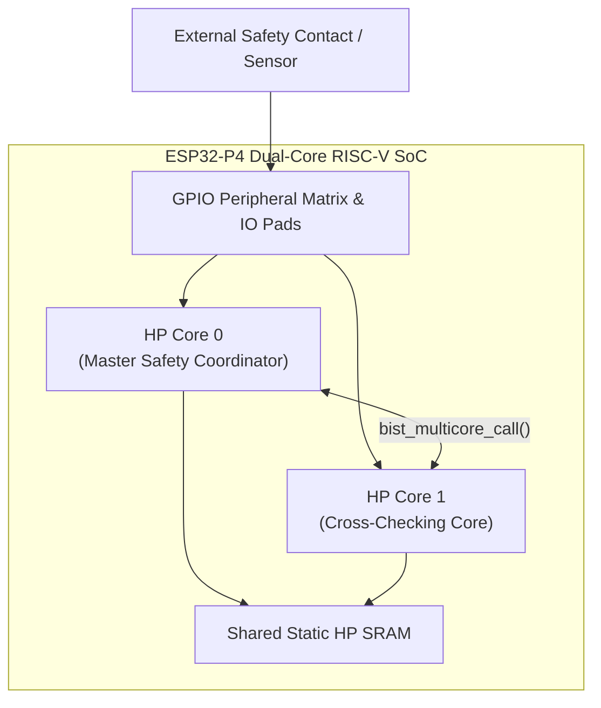
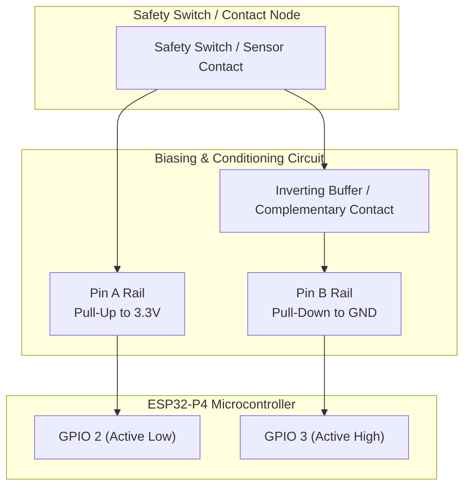
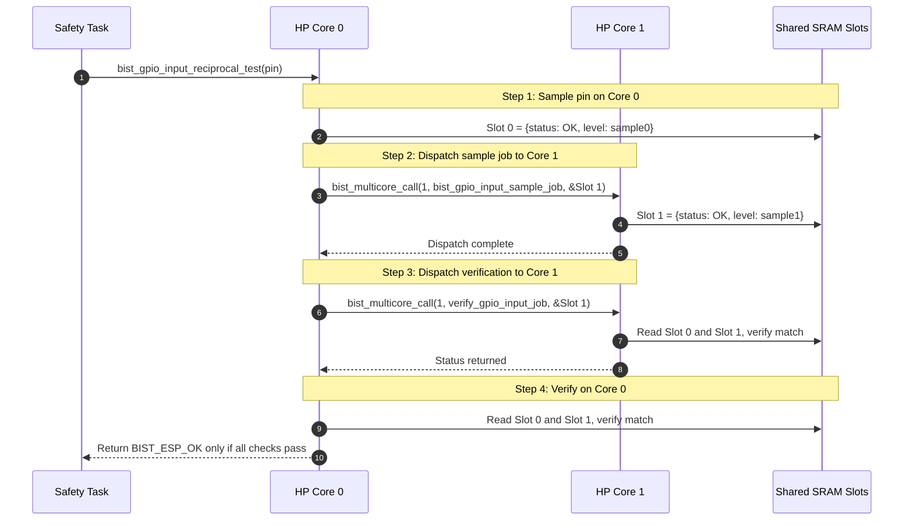
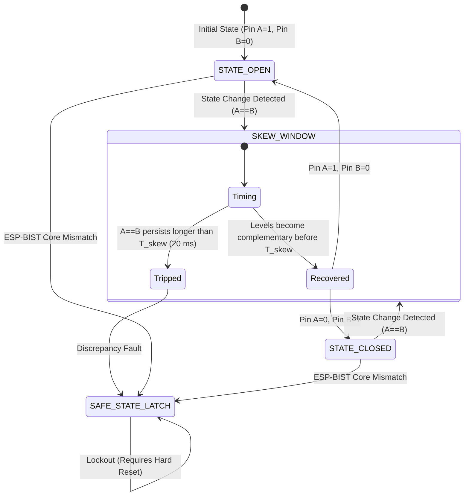



## Introduction

In functional safety, the most dangerous failure is rarely a crash. A crash is loud: execution halts, communication drops, and external watchdogs drop actuator lines. The real hazard is an input pad quietly shorting to ground or a supply rail while the microcontroller carries on as if everything were normal.

Consider an emergency stop button or a high-limit overpressure switch on a boiler. During a hazardous condition, the physical contacts open, but suppose an ESD diode on the input pad has shorted to ground, or an external wire has chafed against the 3.3V rail. The CPU reads the GPIO level register, sees the expected "all clear" bit, and keeps the actuator energized. The firmware runs as written, the RTOS kicks the watchdog on schedule, and the hazard continues unnoticed.

Standard single-channel reads and software watchdogs can't catch this failure mode. A watchdog only confirms that instructions are executing within timing bounds; it can't tell whether a bit in a peripheral register reflects physical reality or an electrical short.

Closing this gap requires moving beyond single-channel polling to a certifiable, fault-tolerant input architecture. This article walks through achieving [IEC 60730](https://en.wikipedia.org/wiki/IEC_60730) Class C compliance for digital GPIO inputs on the [ESP32-P4](https://www.espressif.com/en/products/socs/esp32-p4), pairing complementary hardware biasing with dual-core reciprocal self-tests from [ESP-BIST](https://github.com/espressif/esp-bist).

### Scope of this article

This article focuses strictly on digital GPIO inputs. The architecture, ESP-BIST reciprocal tests, and reference driver below apply to discrete inputs such as emergency stops, safety interlocks, and proof-of-closure switches. The accompanying bare-metal example lives in the [bist-safe-gpio](https://github.com/fdcavalcanti/bist-safe-gpio) repository.

Analog inputs (like ADC channels and ratiometric sensors) and GPIO outputs (such as actuator drivers and dual-channel safety relays) are intentionally out of scope here. Those signal paths require different diagnostic strategies and will be covered in follow-up articles.

> [!WARNING]
> ESP-BIST Class C support, including the reciprocal GPIO input path used here, is currently an internal development and is not yet available to customers. A public release is expected in the coming months, pending certification.


## IEC 60730 Annex H: Class B vs. Class C

IEC 60730-1 ("Automatic electrical controls – Part 1: General requirements") sets safety standards for electronic controls in household appliances, commercial equipment, and building systems. Annex H specifically defines the diagnostic measures microcontrollers and software must implement when handling safety-related functions.

The standard groups control functions into three tiers based on hazard severity:

### Class A: Standard Control Functions

Class A functions aren't relied upon for equipment safety. Examples include room temperature dials, lighting controls, and simple user interface timers. If a Class A function fails, it's an inconvenience or a loss of performance, not a physical hazard.

### Class B: Prevention of Unsafe Operation

Class B functions prevent unsafe operation of controlled equipment. Familiar examples include thermal cutouts in clothes dryers, door interlocks on washing machines, and defrost termination switches in refrigerators.

Annex H requires Class B electronic controls to detect single faults using periodic self-tests or plausibility checks. For input/output peripherals, that means single-channel diagnostic testing or static plausibility checks. In practice, software periodically samples an input, confirms the reading falls within valid bounds, and exercises test patterns during boot or idle periods.

### Class C: Prevention of Special Hazards

Class C functions prevent special hazards—situations where a single failure could lead directly to an explosion, high-pressure vessel rupture, toxic leak, or severe injury:

- Automatic burner controls (monitoring flame presence, air proving switches, and valve proof-of-closure).
- Unvented high-pressure boilers and water heaters.
- Industrial e-stops and two-hand safety controls.

For Class C controls, single-channel static plausibility isn't enough. Table H.1 Component 7.1 mandates dual-channel redundancy, dynamic testing, or reciprocal comparison. The architecture must catch any single electrical or silicon fault before a second fault can develop, forcing the system into a safe state within a defined fault reaction time.

## What ESP-BIST Provides on Espressif Silicon

[ESP-BIST](https://github.com/espressif/esp-bist) is Espressif's LGPL-3.0 Built-In Self Test library for IEC 60730 compliance. It supplies modular diagnostic routines that map directly to Table H.1 requirements across CPU cores, internal memory, clocks, watchdogs, and peripherals. While the library also covers analog signals, outputs, and internal buses to Class C levels, this article focuses specifically on digital GPIO inputs.

The library splits testing into two execution phases:

- **Post-boot tests**: Deep sweeps run immediately after reset before any safety-critical tasks spin up. These include CPU register pattern walks, program counter integrity checks, March and Abraham RAM algorithms, and Flash CRC calculations.
- **Runtime tests**: Non-invasive, deterministic routines called periodically from application control loops to catch latent silicon faults during normal operation.

### Dual-Core Architecture on ESP32-P4

On the ESP32-P4, ESP-BIST implements reciprocal comparison across cores as the primary mechanism to achieve Class C compliance on digital GPIO inputs.

That software path is a critical foundation, but relying on software alone has natural limits when external wiring and physical pads can short or fail open. That is why this article exists: it shows how to use ESP-BIST's reciprocal test, and how to back it up with complementary hardware biasing to build an input channel that can credibly support an IEC 60730 Class C safety claim (which ultimately requires formal certification from accredited testing authorities on the finished equipment).

The ESP32-P4 features two high-performance (HP) 32-bit RISC-V cores running up to 400 MHz alongside a low-power (LP) RISC-V safety companion core. For Class C digital input testing, the two HP cores provide genuine dual-channel execution paths:

<div style="display: flex; justify-content: center;">



</div>

HP Core 0 coordinates the diagnostic sequence, while HP Core 1 takes an independent sample of the exact same physical pad. Both cores cross-check the recorded evidence before the reading is accepted as valid. That dual-core comparison is the software half of the story; the hardware half follows in the next section.


## Hardware Implementation: Dual-Pin Inverted Topology

Software self-tests alone can't detect external wiring faults if both input channels share the same polarity. If two parallel inputs are both pulled high and an external wire breaks, both float high, match each other, and hide the fault.

To achieve complete diagnostic coverage across external wiring, terminal blocks, PCB traces, and silicon pads, the hardware layer uses a complementary, dual-pin inverted biasing scheme. (As noted earlier, this applies strictly to digital inputs; analog sensing and output paths are handled separately.)



### Circuit Operation

The core idea is simple: feed a single physical event into two separate GPIO pins on the ESP32-P4 using opposite logic levels:

- **Pin A (Active Low)**: Biased to 3.3V through a pull-up resistor. Closing the switch pulls the pin to GND (logic `0`); opening it lets the pull-up return the pin to 3.3V (logic `1`).
- **Pin B (Active High)**: Biased to GND through a pull-down resistor and driven with the inverted signal. Closing the switch drives the pin to 3.3V (logic `1`); opening it lets the pull-down return the pin to GND (logic `0`).

On the bench or in a product, there are two practical ways to create that inverted second channel:

1. **A dual-contact switch (best for buttons and interlocks)**: Industrial E-stops and limit switches usually give you both a normally open (NO) and a normally closed (NC) contact in the same housing. Wire one contact to switch Pin A to GND, and the other to switch Pin B to 3.3V over two separate wires. Because the two signals travel independently all the way from the switch to the MCU, you get fault coverage across the external cable, connectors, and PCB traces.
2. **An inverter on the PCB (for single-wire sensors)**: If your sensor only has a single output wire, you can split the trace on the board and run one branch through a simple inverting gate into Pin B. This doesn't give you two separate external wires: a short on the single sensor wire reads as a valid state and is not detected. It still protects everything on the board after the split, including the PCB traces, input pads, and GPIO peripheral.

In the reference example, `safe_gpio_init()` enables the ESP32-P4's internal pull-up and pull-down resistors (~45 kΩ) rather than using external pull resistors. Relying on the internal pulls allows the application to run ESP-BIST's standard post-boot GPIO input test (`bist_gpio_input_test()`, which resets each pin to its default internal pull-up and verifies that it reads logic `1`) at startup before applying the runtime complementary pull configuration. Using external pull-up and pull-down resistors (such as 10 kΩ) is also possible and is recommended for long cable runs or electrically noisy environments where stronger biasing is needed, depending on the application.

### Core Invariant

Under all normal operating conditions, the logic levels of Pin A and Pin B must be strictly complementary:

$$\text{Level}(\text{Pin A}) \oplus \text{Level}(\text{Pin B}) = 1$$

$$\text{Level}(\text{Pin A}) \neq \text{Level}(\text{Pin B})$$

Any condition where \\(\text{Level}(\text{Pin A}) = \text{Level}(\text{Pin B})\\) indicates an electrical fault: an external short, an inter-trace bridge, or a damaged input pad.

### Failure Modes and Effects Analysis (FMEA)

The following matrix documents the diagnostic behavior across all single-point electrical and pad faults:

| Failure Mode | Electrical State on Pin A | Electrical State on Pin B | Sampled Pair `(A, B)` | Software Result | Safe State Reaction |
|---|---|---|---|---|---|
| Normal Run (Switch Closed) | Connected to GND (0V) | Driven High (3.3V) | `(0, 1)` | Valid Active State | Normal operation |
| Normal Standby (Switch Open) | Pulled to 3.3V via pull-up | Pulled to GND via pull-down | `(1, 0)` | Valid Inactive State | Normal operation |
| Short to GND on Pin A | Forced to 0V | Normal (0V or 3.3V) | `(0, 0)` when switch open | Discrepancy Fault | Safe State Latched |
| Short to 3.3V on Pin A | Forced to 3.3V | Normal (0V or 3.3V) | `(1, 1)` when switch closed | Discrepancy Fault | Safe State Latched |
| Short to GND on Pin B | Normal (0V or 3.3V) | Forced to 0V | `(0, 0)` when switch closed | Discrepancy Fault | Safe State Latched |
| Short to 3.3V on Pin B | Normal (0V or 3.3V) | Forced to 3.3V | `(1, 1)` when switch open | Discrepancy Fault | Safe State Latched |
| Inter-Pin Bridge (Trace Short) | Equalized voltage | Equalized voltage | `(0, 0)` or `(1, 1)` | Discrepancy Fault | Safe State Latched |
| Internal Pad Driver Stuck-At | Pad stuck at 0 or 1 | Normal | Mismatch on next toggle | Discrepancy Fault | Safe State Latched |
| Open Wire on Pin A | Floats to 3.3V via pull-up | Normal (0V or 3.3V) | `(1, 1)` when switch closed | Discrepancy Fault | Safe State Latched |
| Open Wire on Pin B | Normal (0V or 3.3V) | Floats to 0V via pull-down | `(0, 0)` when switch closed | Discrepancy Fault | Safe State Latched |


## Software Implementation: Dual-Core Reciprocal Testing with ESP-BIST

On the software side, ESP-BIST provides a dedicated reciprocal digital I/O engine (`bist_gpio_reciprocal.c` and `bist_gpio_reciprocal.h`). It implements the IEC 60730 H.2.18.15 reciprocal comparison pattern across both RISC-V HP cores for a single digital input pin. (Analog channels and output diagnostics are outside the scope of this test and this article.)

### Fail-Closed Execution Sequence

When `bist_gpio_input_reciprocal_test(gpio_num)` runs, it follows a strict four-step verification sequence:



1. **Sample on Core 0**: Core 0 samples the pin via `gpio_get_level(pin)`, and writes `BIST_ESP_OK` alongside the sampled level into Slot 0, if sample succeeds.
2. **Dispatch sample to Core 1**: Core 0 issues a blocking inter-processor call (`bist_multicore_call`) instructing Core 1 to sample the same pin into Slot 1.
3. **Cross-check on Core 1**: Core 0 dispatches a verification job to Core 1. Core 1 inspects both evidence slots. If either slot failed or the sampled levels disagree, Core 1 flags `BIST_ESP_IO_TEST_ERR`.
4. **Cross-check on Core 0**: Core 0 runs the same verification locally. The function returns `BIST_ESP_OK` only if both cores agree that both samples completed successfully and produced identical logic levels.

### Non-Invasive Operation

The reciprocal test only calls `gpio_get_level()`. It doesn't reset pads, flip pin directions, or modify internal pull resistors. Whatever pin configuration your application initialized remains untouched throughout.


## The Complete Safe GPIO Driver Layer

Achieving Class C compliance requires bringing together the dual-core reciprocal read, the hardware complementary check, and a transition filter.

### Mechanical Skew and Debounce Filtering

Physical switches bounce, and mechanical contacts never make or break in perfect synchronization (typical transit skew ranges from 1 ms to 10 ms). During movement, one contact inevitably opens or closes a few milliseconds ahead of the other.

A naive check would trip a discrepancy fault the instant the switch is in flight. To eliminate this problem while maintaining safety limits, the driver implements a configurable discrepancy timeout window, \\(T_{\text{skew}}\\) (set to 20 ms).



If `Pin A == Pin B` persists longer than \\(T_{\text{skew}}\\), the driver immediately cuts actuator power, latches the fault state, and logs the discrepancy.

### Reference Driver Implementation

> [!IMPORTANT]
> IEC 60730 Class C reciprocal GPIO support on the ESP32-P4 is **not** provided through the ESP-IDF application build system. It is available only as a standalone ESP-BIST tool / project. The reference implementation for this article is the bare-metal example in [bist-safe-gpio](https://github.com/fdcavalcanti/bist-safe-gpio) (no ESP-IDF app build, no FreeRTOS).

The [bist-safe-gpio](https://github.com/fdcavalcanti/bist-safe-gpio) driver splits into two layers:

- `src/safe_gpio/safe_gpio.c` — pad setup, `bist_gpio_input_reciprocal_test()` reads, fault callback side effects.
- `src/safe_gpio/safe_gpio_core.c` — skew filter (`safe_gpio_filter_apply()`), host-testable with no hardware access.

Public API: `safe_gpio_init()`, `safe_gpio_sample()`, `safe_gpio_get_fault()`, `safe_gpio_fault_name()`. Dual-pin relationship is selected with `safe_gpio_config_t.mode`:

- `SAFE_GPIO_MODE_COMPLEMENTARY` — valid pairs `(1,0)` / `(0,1)`; closed is `(0, 1)`. Pin A pulled up, Pin B pulled down.
- `SAFE_GPIO_MODE_EQUAL` — valid pairs `(0,0)` / `(1,1)`; closed is `(0, 0)`. Both pins pulled up. This mode cannot detect an inter-pin bridge and is not the recommended Class C topology.

Every level that reaches the skew filter has already passed a reciprocal read. `sample_pin()` calls `bist_gpio_input_reciprocal_test()` and takes the accepted level from Core 0's evidence slot (`bist_gpio_input_shared_results[0].level`). A failed reciprocal read latches `SAFE_GPIO_FAULT_BIST_CORE_MISMATCH`. (Because Core 0 and Core 1 sample sequentially across a microsecond IPC gap, an input edge that transitions right between the two reads can also trigger a single-sample mismatch; production firmware can retry the reciprocal read once before latching to filter out asynchronous edge races.) A pair that stays invalid past the skew window latches `SAFE_GPIO_FAULT_DISCREPANCY` inside the filter.

```c {title="src/safe_gpio/safe_gpio.c (reciprocal read)"}
static esp_err_t sample_pin(gpio_num_t pin, int *out_level)
{
    bist_esp_err_t ret = bist_gpio_input_reciprocal_test(pin);
    if (ret != BIST_ESP_OK) {
        return ESP_FAIL;
    }

    uint32_t level = bist_gpio_input_shared_results[0].level;
    if (level > 1U) {
        return ESP_FAIL;
    }

    *out_level = (int)level;
    return ESP_OK;
}
```

```c {title="src/safe_gpio/safe_gpio_core.c (skew window)"}
if (pair_is_valid(filter->mode, level_a, level_b)) {
    filter->skew_active = false;
    filter->skew_start_us = 0;
    *out_state = decode_state(filter->mode, level_a, level_b);
    return SAFE_GPIO_FAULT_NONE;
}

if (!filter->skew_active) {
    filter->skew_active = true;
    filter->skew_start_us = now_us;
    return SAFE_GPIO_FAULT_NONE; /* hold previous state while in flight */
}

if ((now_us - filter->skew_start_us) >=
        (int64_t)filter->discrepancy_timeout_ms * 1000) {
    return latch(filter, SAFE_GPIO_FAULT_DISCREPANCY, out_state);
}
```

### Safety Task and Actuator Control

At startup, `main()` sets the actuator and fault indicator pins to a safe, de-energized state, runs ESP-BIST's standard post-boot GPIO input plausibility check (`bist_gpio_input_test()`) on both pins using their default internal pull-ups (just like the ESP-BIST standalone sample), initializes the driver with `safe_gpio_init()` (in complementary mode with internal pull-up/pull-down and a 20 ms skew window), and arms a 200 ms watchdog. From there, it drops into a 1 ms loop that samples the inputs, updates the actuator output whenever the switch is confirmed closed, and feeds the watchdog.

If a fault occurs, the driver's callback immediately cuts the actuator output and turns on the fault LED using `gpio_set_level()`, and the main loop calls `fail_safe_exit()`. In a real product, `fail_safe_exit()` is where your system's fault exit strategy lives. What "safe" means depends entirely on what you are building (it might mean shutting off a heater, closing a fuel valve, engaging a brake, or saving a fault code to flash before letting the watchdog reset the chip) so you tailor this function to match your product's safety requirements.

```c {title="main/main.c (supervision loop)"}
if (safe_gpio_sample(&state) != ESP_OK) {
    fail_safe_exit(safe_gpio_fault_name(safe_gpio_get_fault()));
}

bool closed = (state == SAFE_GPIO_STATE_CLOSED);
if (closed != last_closed) {
    last_closed = closed;
    gpio_set_level(SAFE_GPIO_ACTUATOR_PIN, closed ? 1 : 0);
}

wdt_feed();
wait_until(next_sample_us);
```

### Building and Running the Example

Clone [bist-safe-gpio](https://github.com/fdcavalcanti/bist-safe-gpio) and build it as an ESP-BIST standalone target (ESP-IDF supplies headers and toolchain only). A Dev Container is the suggested way to get a consistent ESP-BIST toolchain; its usage is demonstrated in the official [ESP-BIST repository](https://github.com/espressif/esp-bist). The project's `bist.conf` already enables reciprocal GPIO testing, multicore dispatch, and the 200 ms watchdog timeout by default:


```sh
export IDF_PATH=/path/to/esp-idf        # Already present in devcontainer
export MCUBOOT_PATH=/path/to/mcuboot    # Already present in devcontainer
export ESP_BIST_PATH=/path/to/esp-bist

cmake -GNinja -B build -DSOC_TARGET=esp32p4 .
ninja -C build
ninja -C build flash_boot   # MCUboot bootloader, first flash only
ninja -C build flash
ninja -C build monitor
```

A healthy run logs the post-boot GPIO input self-test, then contact transitions. Jumpering or bridging the pins produces `Safe state latched: <cause>` and `Fail-safe stop: <cause>`, with the actuator low and the indicator lit until reset.

## Bench Testing and Verification

To verify diagnostic coverage, we evaluated the reference setup on an ESP32-P4 test bench with deliberate physical fault injection.

### Test Bench Configuration

- **Target SoC**: ESP32-P4 RISC-V Dual-Core Evaluation Board (ESP32-P4-Function-EV-Board).
- **Wiring Harness**:
  - `GPIO 2`: Pin A configured as input with internal pull-up to 3.3V.
  - `GPIO 3`: Pin B configured as input with internal pull-down to GND.
  - `GPIO 4`: Actuator control output driving a high-speed relay simulator.
  - `GPIO 5`: Safety fault indicator output.
- **Instrumentation**: 4-channel digital oscilloscope / logic analyzer monitoring Pin A, Pin B, Actuator Enable, and Fault Out.

### Fault Injection Test Matrix

The following four test scenarios evaluated fault detection and timing:

| Test Case | Injected Fault Condition | Method | Expected Observation |
|---|---|---|---|
| **TC01: Nominal Cycling** | Normal switch actuation | Manual toggle | Clean complementary transitions `(1,0)` ↔ `(0,1)` |
| **TC02: Short to GND on Pin A** | Pin A jumpered to 0V while switch open | Physical GND jumper | Inputs read `(0, 0)`; discrepancy timeout expires |
| **TC03: Short to 3.3V on Pin B** | Pin B jumpered to 3.3V while switch open | Physical 3.3V jumper | Inputs read `(1, 1)`; discrepancy timeout expires |
| **TC04: Inter-Pin Bridge** | Pin A shorted directly to Pin B | Direct trace jumper | Inputs equalize to identical logic level; discrepancy trip |

#### Signal analyzer captures

The captures below show Pin A, Pin B, Output, and Safety Fault for normal switching (TC01) and the two fault cases: both pins low `(0, 0)` (TC02) and both pins high `(1, 1)` (TC03). (Bridging the two pins together in TC04 looks just like TC02 or TC03 once a closed contact or asymmetrical external pull biases the shorted node to a rail.) In the fault captures (TC02 and TC03), notice that the system doesn't trip the instant the fault happens. It waits out the 20 ms skew window first and only shuts down once the mismatch stays past that limit.







## Conclusion & Best Practices

Achieving IEC 60730 Class C compliance for digital GPIO inputs comes down to eliminating single points of failure across both the physical interface and internal microcontroller registers.

On the ESP32-P4, that Class C reciprocal path is delivered only through the standalone ESP-BIST tool, not through an ESP-IDF application component. The [bist-safe-gpio](https://github.com/fdcavalcanti/bist-safe-gpio) example pairs dual-pin hardware biasing with `safe_gpio_init()` / `safe_gpio_sample()`, modes `SAFE_GPIO_MODE_COMPLEMENTARY` / `SAFE_GPIO_MODE_EQUAL`, reciprocal reads via `bist_gpio_input_reciprocal_test()`, and discrepancy latching through `safe_gpio_filter_apply()` / `SAFE_GPIO_FAULT_DISCREPANCY`.

1. **External single-channel faults** (ground shorts, supply shorts, and broken wires) are caught at the next actuation by the dual-pin invariant \\(\text{Level}(\text{Pin A}) \neq \text{Level}(\text{Pin B})\\) in complementary mode.
2. **Per-core read-path and execution faults** (core execution errors and transient bus errors) are caught when HP Core 0 and HP Core 1 cross-validate each pad before the skew filter sees the level. Pad or register stuck-at faults affect both cores equally and are caught by the dual-pin invariant at the next state change.
3. **Transition skew and contact bounce** are tolerated through the discrepancy timeout window. A persistent invalid pair latches within \\(T_{\text{skew}}\\) plus one to two sample periods.

### Next Steps for System Integrators

- **Stay on the standalone BIST path for Class C on P4**: Do not expect ESP-IDF app projects to expose this reciprocal GPIO Class C flow; build and flash through ESP-BIST using [bist-safe-gpio](https://github.com/fdcavalcanti/bist-safe-gpio).
- **Enforce Fail-Closed Outputs**: Pair safe digital inputs with dual-channel actuator outputs (e.g., high-side and low-side switches in series) so that an output driver short-circuit cannot prevent safe shutdown. Output-side Class C coverage is a follow-on topic.
- **Reference repository — [bist-safe-gpio](https://github.com/fdcavalcanti/bist-safe-gpio)**: Clone and build this example (preferably inside the Dev Container workflow shown in the official [ESP-BIST](https://github.com/espressif/esp-bist) repository), then inspect the reciprocal digital I/O routines alongside the ESP-BIST sources.

## Links of interest

- [bist-safe-gpio](https://github.com/fdcavalcanti/bist-safe-gpio) — Bare-metal ESP-BIST Class C safe GPIO example for ESP32-P4 used throughout this article.
- [ESP-BIST](https://github.com/espressif/esp-bist) — Official Built-In Self Test library, including Dev Container setup for the standalone toolchain.
- [ESP-BIST in Action: A Self-Testing HMI using ESP32-P4](/blog/2026/08/esp-bist-motor-controller-hmi/) — Companion article on ESP-BIST Class B self-tests and Host Diagnostics on an ESP32-P4 Modbus HMI.
