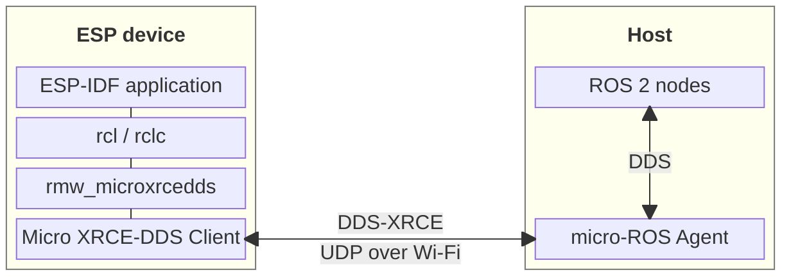

ROS 2 is widely used in robotics to connect software components running on different devices, and provides a rich ecosystem of tools and libraries. However, a typical ROS 2 installation targets systems that provide a relatively complete operating system and considerably more resources than a microcontroller.

This is where micro-ROS comes in.

micro-ROS brings the core concepts and APIs of ROS 2 to microcontrollers, allowing embedded devices to participate in a ROS 2 system while continuing to run an RTOS and application framework designed for constrained devices.

For Espressif developers, the [micro_ros_espidf_component](https://github.com/micro-ROS/micro_ros_espidf_component) provides micro-ROS integration for ESP-IDF. It allows applications running on supported ESP SoCs to create ROS 2 nodes, publishers, subscribers, services, timers, and other ROS entities using the micro-ROS client libraries. The component is now available in the [ESP Component Registry](https://components.espressif.com/components/micro-ros/micro_ros_espidf_component).

This article explains the micro-ROS communication model, then shows how to use `micro_ros_espidf_component` so an ESP device can join a ROS 2 network, publish, and subscribe. It also shows how to add the component to your own project. It assumes you already know the basics of ESP-IDF, ESP-IDF components, and ROS 2.

## What you will run

Three programs cooperate:

1. An ESP-IDF application on the board. It creates a ROS 2 node and publishes or subscribes.
2. The micro-ROS Agent on your computer. It represents the board inside the ROS 2 network.
3. The ROS 2 command-line tools on your computer. They list the board's node, print messages published by the board, and publish messages to topics the board subscribes to.

## How the board joins the ROS 2 graph

On a PC, one process can publish and another can subscribe without either process knowing the other's address. This is made possible by DDS (Data Distribution Service), a middleware standard used by ROS 2 that enables publishers and subscribers to discover each other and exchange data automatically. To fit resource-constrained devices, micro-ROS splits this work by default between a lightweight client on the board and an Agent on the host.

This tutorial uses the component's default middleware, [eProsima Micro XRCE-DDS](https://micro-xrce-dds.docs.eprosima.com/en/latest/#overview), over UDP. In this configuration, the board needs the Agent to create DDS entities on its behalf and forward application data. After the session is up, tools such as `ros2 node list` see an ordinary ROS 2 node.



On the device, [rcl](https://docs.ros.org/en/jazzy/Concepts/Basic/About-Client-Libraries.html) is the core client library. [rclc](https://github.com/ros2/rclc/blob/jazzy/README.md) provides convenience functions for initialization and an executor that runs your callbacks. Your application uses these APIs, while the component provides the middleware that handles communication with the Agent.

The component also includes `embeddedRTPS`, an experimental middleware option designed for direct communication with ROS 2 without an Agent. The [component README](https://github.com/micro-ROS/micro_ros_espidf_component/blob/jazzy/README.md#middlewares-available) lists this option as currently nonfunctional.

This tutorial uses the default Wi-Fi and UDP configuration. The component also supports other transports, such as UART. For other transport options, refer to the [examples](https://github.com/micro-ROS/micro_ros_espidf_component/tree/jazzy/examples) provided in the `micro_ros_espidf_component`.

## Choose a ROS 2 distribution and component version

Choose a ROS 2 distribution before continuing. The current distributions are listed on the [ROS 2 releases page](https://docs.ros.org/en/rolling/Releases.html). Make sure that your host ROS 2 installation, micro-ROS Agent, and `micro_ros_espidf_component` all use the same ROS 2 distribution.

`micro_ros_espidf_component` supports several ROS 2 distributions, and it uses a version scheme of its own. The major version is the last two digits of the ROS 2 distribution's release year:

| ROS 2 distribution | Release year | Component version family | Agent image tag |
| ------------------ | ------------ | ------------------------ | --------------- |
| Humble             | 2022         | `22.x.y`                 | `humble`        |
| Iron               | 2023         | `23.x.y`                 | `iron`         |
| Jazzy              | 2024         | `24.x.y`                 | `jazzy`        |
| Kilted             | 2025         | `25.x.y`                 | `kilted`       |
| Lyrical            | 2026         | `26.x.y`                 | `lyrical`      |
| Rolling            | -            | `nn.x.y-rolling.date`    | `rolling`      |

Check the [ESP Component Registry](https://components.espressif.com/components/micro-ros/micro_ros_espidf_component) for a release that exists for your distribution, and read that release's README for supported ESP-IDF versions and chips.

The commands in this guide use ROS 2 Jazzy, component version `24.0.0`, and the `jazzy` Agent image as an example. If you are using a different distribution, remember to adjust the versions and tags in the commands accordingly.

The Rolling distribution is a special case: its component version is marked as a pre-release of the next major version. Therefore, you must explicitly specify the component version when using it.

## Preparation

### Install ROS 2

Install the ROS 2 distribution you selected, following its installation instructions on the [ROS 2 releases page](https://docs.ros.org/en/rolling/Releases.html). The ROS-Base package is sufficient to complete this tutorial. Alternatively, you can use the Desktop package, which is recommended if you plan to explore ROS 2 further.

### Prepare the micro-ROS Agent

Choose how to run the Agent. To use the official Docker image, install [Docker Engine](https://docs.docker.com/engine/install/) and confirm that `docker run hello-world` works. Alternatively, build the Agent in your local ROS 2 environment by following [Building micro-ROS-Agent](https://github.com/micro-ROS/micro_ros_setup#building-micro-ros-agent).

### Install Python dependencies for ESP-IDF

Activate the ESP-IDF environment in a shell (but not the ROS 2 environment), then install the Python packages the component uses to build the micro-ROS library:

```bash
. "$IDF_PATH/export.sh"
python -m pip install catkin_pkg colcon-common-extensions lark
```

### Prepare the board and Wi-Fi network

Prepare a Wi-Fi-capable ESP development board with a USB-UART or USB-Serial-JTAG interface. Supported ESP chips are listed in the [component README](https://github.com/micro-ROS/micro_ros_espidf_component#micro-ros-component-for-esp-idf) for the release you selected.

We will connect the board over Wi-Fi to the same LAN as the host. The access point has to use a band the chip supports, because some ESP chips provide only 2.4 GHz Wi-Fi. You also need the host's IP address on that LAN. In a terminal:

```bash
hostname -I
```

Note down the correct IPv4 address, as you will need it later when configuring the project.

### Prepare the terminals

Prepare three separate terminals. The rest of the tutorial refers to them by these names:

| Terminal | Environment | What it does |
| -------- | ----------- | ------------ |
| ESP-IDF terminal | ESP-IDF, with **no ROS 2 setup script sourced** | Configure, build, flash, and monitor the board |
| Agent terminal | Docker, or ROS 2 if you build the Agent locally | Run the micro-ROS Agent |
| ROS 2 terminal | ROS 2 | Inspect nodes and topics, and exchange messages with the board |

## Publish and subscribe from the board

In the component's `int32_sub_pub` example, the board sends an integer counter to ROS 2 once a second. The counter starts at `0` and increases by one each time. The board also receives integers sent from ROS 2 and prints them in the serial monitor. The following steps show how to run the example and exchange messages in both directions.

### Start the Agent

In the Agent terminal, start the micro-ROS Agent using either Docker or a locally built Agent. Both commands below use UDP port `8888`; you will use the same port when configuring the board. `udp4` selects UDP over IPv4.

To start the Agent with Docker, run:

```bash
docker run -it --rm --net=host \
  microros/micro-ros-agent:jazzy udp4 --port 8888
```

Replace `jazzy` with the image tag for your ROS 2 distribution from the version table. The first Docker run downloads the image. `--net=host` makes the container share the host network, so the board can reach the Agent through the host's IP address.

Alternatively, to run a locally built Agent, follow [Building micro-ROS-Agent](https://github.com/micro-ROS/micro_ros_setup#building-micro-ros-agent), then start it from the sourced Agent workspace:

```bash
ros2 run micro_ros_agent micro_ros_agent udp4 --port 8888
```

Wait until the Agent reports that it is listening on port `8888`, then leave this terminal running:

```text
[1794314384.202119] info     | UDPv4AgentLinux.cpp | init                     | running...             | port: 8888
[1794314384.202338] info     | Root.cpp           | set_verbose_level        | logger setup           | verbose_level: 4
```

With the Agent listening, switch to the ESP-IDF terminal to create and run the board application.

### Create the example project

In the ESP-IDF terminal, go to the directory where you keep projects, activate ESP-IDF, and create the example. The example command below uses version `24.0.0`, the latest component version for Jazzy at the time of writing. Since newer versions may have been released, we recommend checking the [Registry page](https://components.espressif.com/components/micro-ros/micro_ros_espidf_component) for the latest version available for your ROS 2 distribution.

```bash
. "$IDF_PATH/export.sh"
idf.py create-project-from-example "micro-ros/micro_ros_espidf_component=24.0.0:int32_sub_pub"
cd int32_sub_pub
```

The generated project automatically declares `micro_ros_espidf_component` as a dependency in `main/idf_component.yml`, so you don't need to add it separately with `add-dependency`.

### Select the chip and set the network

Continue in the ESP-IDF terminal and set the target to match your board. For example, for an ESP32-C3:

```bash
idf.py set-target esp32c3
```

> [!NOTE]
> The first configuration takes longer than a normal ESP-IDF project. During `idf.py set-target`, the component downloads upstream sources and builds the micro-ROS library.

Open the configuration menu:

```bash
idf.py menuconfig
```

Under `micro-ROS Settings`, keep `micro-ROS over eProsima Micro XRCE-DDS`. For Wi-Fi, select `WLAN interface` under `micro-ROS network interface select`, then set:

| Setting | Value |
| ------- | ----- |
| WiFi Configuration → WiFi SSID | Your network name |
| WiFi Configuration → WiFi Password | Your network password |
| micro-ROS Agent IP | The computer's LAN address |
| micro-ROS Agent Port | `8888` |

These settings connect the board to your Wi-Fi network and point the micro-ROS client at the running Agent.

### Build, flash, and watch the serial log

In the ESP-IDF terminal:

```bash
idf.py build
idf.py flash monitor
```

If the serial port is ambiguous, pass it explicitly: `idf.py -p PORT flash monitor`.

A successful Wi-Fi connection logs a line similar to `wifi_station_netif: got ip:192.168.1.20`. The address will be the board's address.

After the board connects to Wi-Fi, the Agent terminal shows the client connecting and the communication entities being created. Client keys, addresses, and timestamps will differ:

```text
[1794314543.998328] info     | Root.cpp           | create_client            | create                 | client_key: 0x2A0577FE, session_id: 0x81
[1794314543.999721] info     | SessionManager.hpp | establish_session        | session established    | client_key: 0x2A0577FE, address: 10.18.37.251:11737
[1794314544.203775] info     | ProxyClient.cpp    | create_participant       | participant created    | client_key: 0x2A0577FE, participant_id: 0x000(1)
[1794314544.367342] info     | ProxyClient.cpp    | create_topic             | topic created          | client_key: 0x2A0577FE, topic_id: 0x000(2), participant_id: 0x000(1)
[1794314544.405101] info     | ProxyClient.cpp    | create_publisher         | publisher created      | client_key: 0x2A0577FE, publisher_id: 0x000(3), participant_id: 0x000(1)
[1794314544.577982] info     | ProxyClient.cpp    | create_datawriter        | datawriter created     | client_key: 0x2A0577FE, datawriter_id: 0x000(5), publisher_id: 0x000(3)
[1794314544.666936] info     | ProxyClient.cpp    | create_topic             | topic created          | client_key: 0x2A0577FE, topic_id: 0x001(2), participant_id: 0x000(1)
[1794314544.709646] info     | ProxyClient.cpp    | create_subscriber        | subscriber created     | client_key: 0x2A0577FE, subscriber_id: 0x000(4), participant_id: 0x000(1)
[1794314544.759242] info     | ProxyClient.cpp    | create_datareader        | datareader created     | client_key: 0x2A0577FE, datareader_id: 0x000(6), subscriber_id: 0x000(4)
```

`session established` means the board reached the Agent. The lines that follow show the Agent creating DDS entities on the board's behalf: a participant, then the entities used to publish and subscribe. The two `topic created` lines correspond to the example's two topics. The log does not show their names; you will inspect those from the ROS 2 terminal next.

The serial monitor in the ESP-IDF terminal then shows the application publishing:

```text
Sent: 0
Sent: 1
Sent: 2
Sent: 3
```

Those lines mean the firmware called the publish function. The next step checks that a ROS 2 subscriber actually receives the values, and then sends a value back to the board.

### Exchange messages from ROS 2

Leave the Agent and serial monitor running. In the ROS 2 terminal, source your ROS 2 setup script and list the nodes. If you installed a different ROS 2 distribution, replace `jazzy` with its name:

```bash
source /opt/ros/jazzy/setup.bash
ros2 node list
```

The board's node appears as:

```text
/int32_publisher_subscriber_rclc
```

Inspect both topics:

```bash
ros2 topic info /int32_publisher
ros2 topic info /int32_subscriber
```

`/int32_publisher` should report the type `std_msgs/msg/Int32` and one publisher. `/int32_subscriber` should report the same type and one subscriber.

Subscribe to the counter the board publishes:

```bash
ros2 topic echo /int32_publisher
```

```text
data: 12
---
data: 13
---
data: 14
---
```

The first value is often greater than zero, because the board has been publishing since the application started. Press Ctrl-C to stop echoing. The timer callback publishes each value on the board; Micro XRCE-DDS carries it to the Agent, which forwards it to the `ros2` subscriber through DDS.

Send one integer to the topic the board subscribes to:

```bash
ros2 topic pub --once /int32_subscriber std_msgs/msg/Int32 "{data: 42}"
```

The serial monitor in the ESP-IDF terminal prints:

```text
Received: 42
```

`--once` publishes a single message and exits. Omit it to publish repeatedly until you press Ctrl-C. Each value you send should show up as `Received:` on the board, while `Sent:` continues to print the outgoing counter. In this direction, DDS carries the message to the Agent, which forwards it to the board and its subscription callback.

## How the example code works

The source is `examples/int32_sub_pub/main/main.c` in the component. The [Jazzy version](https://github.com/micro-ROS/micro_ros_espidf_component/blob/jazzy/examples/int32_sub_pub/main/main.c) is used below. The file publishes the counter and receives integers from the PC.

### Connect to the network and start the task

`app_main()` brings up the network, then starts the micro-ROS work in its own FreeRTOS task. The task stack and priority come from `micro-ROS example-app settings` in menuconfig.

```c {title="main/main.c"}
void app_main(void)
{
#if defined(CONFIG_MICRO_ROS_ESP_NETIF_WLAN) || defined(CONFIG_MICRO_ROS_ESP_NETIF_ENET)
    ESP_ERROR_CHECK(uros_network_interface_initialize());
#endif

    xTaskCreate(micro_ros_task,
            "uros_task",
            CONFIG_MICRO_ROS_APP_STACK,
            NULL,
            CONFIG_MICRO_ROS_APP_TASK_PRIO,
            NULL);
}
```

`uros_network_interface_initialize()` starts a Wi-Fi station with the SSID and password from menuconfig. It blocks until the station has an IP address, or until the configured connection retries are exhausted. The micro-ROS task starts when this function returns.

### Connect to the Agent

Inside `micro_ros_task()`, the client is pointed at the Agent you configured:

```c {title="main/main.c"}
rcl_allocator_t allocator = rcl_get_default_allocator();
rcl_init_options_t init_options = rcl_get_zero_initialized_init_options();
RCCHECK(rcl_init_options_init(&init_options, allocator));

rmw_init_options_t *rmw_options = rcl_init_options_get_rmw_init_options(&init_options);
RCCHECK(rmw_uros_options_set_udp_address(
    CONFIG_MICRO_ROS_AGENT_IP,
    CONFIG_MICRO_ROS_AGENT_PORT,
    rmw_options));

rclc_support_t support;
RCCHECK(rclc_support_init_with_options(&support, 0, NULL, &init_options, &allocator));
```

`RCCHECK` prints the failing line and deletes the current task when an `rcl` call does not return `RCL_RET_OK`. `rmw_uros_options_set_udp_address()` stores the Agent IP and port. `rclc_support_init_with_options()` then connects and prepares the support object that the node and timer need. The `0, NULL` arguments mean the node takes no command-line arguments, which is normal on a microcontroller.

### Create the node, publisher, and subscriber

The node, publisher, and subscriber come next:

```c {title="main/main.c"}
RCCHECK(rclc_node_init_default(&node, "int32_publisher_subscriber_rclc", "", &support));

RCCHECK(rclc_publisher_init_default(
    &publisher,
    &node,
    ROSIDL_GET_MSG_TYPE_SUPPORT(std_msgs, msg, Int32),
    "int32_publisher"));

RCCHECK(rclc_subscription_init_default(
    &subscriber,
    &node,
    ROSIDL_GET_MSG_TYPE_SUPPORT(std_msgs, msg, Int32),
    "int32_subscriber"));
```

`rclc_node_init_default()` takes the node name and the namespace. An empty namespace places the node at `/int32_publisher_subscriber_rclc`. `rclc_publisher_init_default()` binds a publisher to that node, to the `std_msgs/msg/Int32` type support, and to `int32_publisher`. `rclc_subscription_init_default()` does the same for a subscriber on `int32_subscriber`. On the command line those topics are `/int32_publisher` and `/int32_subscriber`.

A one-second timer publishes `send_msg`. The subscription callback reads `recv_msg`, which is the buffer filled with incoming data before the executor invokes the subscription callback:

```c {title="main/main.c"}
std_msgs__msg__Int32 send_msg;
std_msgs__msg__Int32 recv_msg;

void timer_callback(rcl_timer_t *timer, int64_t last_call_time)
{
    (void) last_call_time;
    if (timer != NULL) {
        RCSOFTCHECK(rcl_publish(&publisher, &send_msg, NULL));
        printf("Sent: %d\n", (int) send_msg.data);
        send_msg.data++;
    }
}

void subscription_callback(const void *msgin)
{
    const std_msgs__msg__Int32 *msg = (const std_msgs__msg__Int32 *) msgin;
    printf("Received: %d\n", (int) msg->data);
}
```

`rcl_publish()` sends the message object. The third argument is an optional structure for middleware-specific memory preallocation. This example passes `NULL`. `RCSOFTCHECK` logs a failed publish and continues, so one missed transfer does not delete the task. Both messages are `std_msgs__msg__Int32`. The only field is `data`. The callback receives that buffer as `const void *` and casts it back to the message type.

### Run the callbacks with an executor

The executor runs the timer and subscription callbacks. The application must register both with the executor and call its spin function to process them.

```c {title="main/main.c"}
RCCHECK(rclc_timer_init_default2(
    &timer,
    &support,
    RCL_MS_TO_NS(1000),
    timer_callback,
    true));

RCCHECK(rclc_executor_init(&executor, &support.context, 2, &allocator));
RCCHECK(rclc_executor_add_timer(&executor, &timer));
RCCHECK(rclc_executor_add_subscription(
    &executor, &subscriber, &recv_msg, &subscription_callback, ON_NEW_DATA));

send_msg.data = 0;
while (1) {
    rclc_executor_spin_some(&executor, RCL_MS_TO_NS(100));
    usleep(100000);
}
```

`rclc_executor_init()` reserves room for two handles: the timer and the subscription. Timers, subscriptions, services, and clients each consume one handle. A publisher does not consume an executor handle, because publishing does not require an executor callback. `ON_NEW_DATA` runs the subscription callback when a message arrives. `rclc_executor_spin_some()` waits up to 100 ms for work, runs due callbacks, and returns. The loop repeats that forever. Creating a subscription does not start a background thread. In this example, stopping the spin loop stops both the timer-driven publishing and the subscription callbacks. Code placed after the loop, including the `rcl_*_fini()` cleanup in the example, does not run until you change the loop.

To publish your own data, fill `send_msg.data` with a sensor reading or another integer before `rcl_publish()`.

## Add the component to your own project

Add the micro-ROS component as a dependency by running the following command from the root of your ESP-IDF project.

```bash
idf.py add-dependency "micro-ros/micro_ros_espidf_component^24"
```

Alternatively, add the following dependency to `main/idf_component.yml`.

```yaml
dependencies:
  micro-ros/micro_ros_espidf_component: "^24"
```

`^24` selects a `24.x.y` release for ROS 2 Jazzy. For another stable ROS 2 distribution, replace `24` with the corresponding major version from the [version table](#choose-a-ros-2-distribution-and-component-version). For Rolling, specify an available pre-release version explicitly.

Run `idf.py reconfigure` so the new options show up in menuconfig.

The dependency supplies headers and the static library. The application still has to do the work you saw in the example:

1. Establish a network connection before starting the micro-ROS task. For a new application, use `uros_network_interface_initialize()` as in the example; for an application that already connects to the network, reuse that connection.
2. Set the Agent UDP address and create the `rclc` support object.
3. Create the node, then create the entities your application needs, such as publishers, subscriptions, or services.
4. If your application uses subscriptions, timers, or services, add them to an executor and call `rclc_executor_spin_some()` in a loop to run their callbacks.
5. For topic communication, use `rcl_publish()` to send messages and subscription callbacks to handle incoming messages.

Keep the Agent and the host ROS 2 installation on the same distribution as the component. You can use `ros2 topic echo` and `ros2 topic pub` to test your application's topics from the PC, as you did with the example.

> [!IMPORTANT]
> The upstream project states that this software is not ready for production use and has not been developed or tested for a specific use case. Evaluate it against your own requirements before relying on it in a product, especially in a safety-related setting. See the component's repository [README](https://github.com/micro-ROS/micro_ros_espidf_component/blob/jazzy/README.md#purpose-of-the-project).

### Adjust entity limits

When the component builds the micro-ROS library, it reads the entity limits from its [colcon.meta](https://github.com/micro-ROS/micro_ros_espidf_component/blob/jazzy/colcon.meta). By default, the library reserves memory for one node, two publishers, two subscriptions, one service server, and one service client.

To override the default limits, add an `app-colcon.meta` file at the ESP-IDF project root using the same format as `colcon.meta`. Include the settings you want to override. The example below raises the publisher limit to three.

```json {title="app-colcon.meta"}
{
    "names": {
        "rmw_microxrcedds": {
            "cmake-args": [
                "-DRMW_UXRCE_MAX_PUBLISHERS=3"
            ]
        }
    }
}
```

If you've already built the project, run `idf.py clean-microros`, then `idf.py reconfigure` and `idf.py build` to rebuild with the new limits.

## Where to go next

Explore the other [examples](https://github.com/micro-ROS/micro_ros_espidf_component/tree/jazzy/examples) in the component to learn about more micro-ROS features:

* `addtwoints_server` is a service server. A service is a request and a response, which is a better fit than a topic when the PC asks the board to compute something and waits for the result.
* `parameters` stores named values that other ROS 2 tools can read and write.
* `int32_publisher_custom_transport` replaces Wi-Fi with a UART transport and a serial Agent.

The [micro-ROS documentation](https://micro.vulcanexus.org/docs/overview/features/) describes the client features in more detail, and the [ROS 2 beginner CLI tutorials](https://docs.ros.org/en/jazzy/Tutorials/Beginner-CLI-Tools.html) are the matching guide for the PC side.
