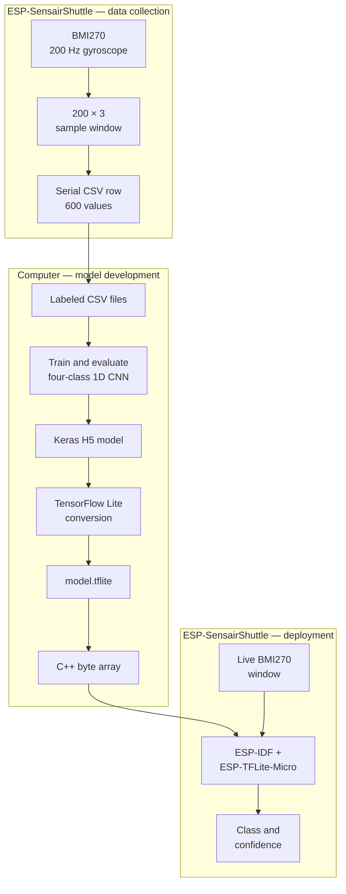

## Machine learning on microcontrollers

Machine-learning development normally separates **training** from **inference**. Training adjusts a model's parameters from a dataset and typically runs on a workstation or cloud service. Inference uses the trained model to classify new input. A sufficiently small model can run directly on a microcontroller.

**Edge AI** is the practice of running inference on the device that collects the data, or close to it, instead of sending the data to a remote service. The name refers to position in a network: cloud services sit at its center, while the devices interacting with the physical world sit at its outer boundary -- the edge.

In this workshop, the BMI270 produces gyroscope samples and the ESP32-C5 classifies them on the ESP-SensairShuttle. The samples do not need to leave the board.

Local inference is useful when an application needs:

- **Low latency** — the result does not wait for a network round trip.
- **Offline operation** — classification continues without Wi-Fi or a cloud service.
- **Privacy** — raw sensor data can remain on the device.
- **Lower bandwidth use** — the device can transmit a result instead of a continuous sensor stream.
- **Predictable availability and cost** — inference does not depend on a remote API.

Cloud inference remains useful when the model is too large for the target, must aggregate information from many devices, or changes too frequently to deploy with firmware. Many products combine both approaches: immediate decisions run locally, while selected events or summaries are sent to a backend.

Microcontroller deployment also imposes limits. Flash stores the program and model, RAM holds tensors and working buffers, and the CPU must finish inference within the application's timing budget. These constraints influence the model architecture, operators, numeric types, and input size.

[TensorFlow Lite Micro](https://ai.google.dev/edge/litert/microcontrollers/overview) is an inference runtime designed for microcontrollers and other constrained systems. It avoids assumptions such as a full operating system and lets the application provide a fixed memory workspace. The [ESP-TFLite-Micro](https://components.espressif.com/components/espressif/esp-tflite-micro) component packages this runtime for ESP-IDF and integrates ESP-NN kernels — implementations of individual network operations, such as convolution, tuned for Espressif chips — where one is available.

### ESP-TFLite-Micro and ESP-NN

A TensorFlow Lite Micro application combines the converted model with a small runtime:

| Part | Role |
| --- | --- |
| TensorFlow Lite model | A FlatBuffer containing the network graph, tensor metadata, and trained weights. Embedded firmware normally stores it as a C or C++ byte array. |
| `MicroInterpreter` | Reads the model, prepares tensors, and executes the graph when the application calls `Invoke()`. |
| Operator resolver | Registers only the kernels required by the model, such as convolution, pooling, fully connected, and softmax. A missing operator causes model initialization or invocation to fail. |
| Tensor arena | A contiguous memory buffer supplied by the application for input, output, intermediate tensors, persistent data, and scratch buffers. Its required size depends on the converted model. |
| Input and output tensors | The interface between application code and the model. Their shape and numeric type must match the training and conversion pipeline. |

The runtime sequence is:

1. Read the embedded FlatBuffer and verify its schema version.
2. Register the operators used by the model.
3. Create the interpreter with a tensor arena.
4. Allocate tensors and obtain the input and output tensor pointers.
5. Copy preprocessed sensor values into the input tensor.
6. Call `Invoke()`.
7. Interpret the output scores and apply application-level confidence rules.

The tensor arena is not the same as the `.tflite` file size. It also contains intermediate activations and temporary buffers. If it is too small, `AllocateTensors()` fails. Measure and tune it with the final converted model rather than estimating it only from the model file.

[ESP-NN](https://github.com/espressif/esp-nn) provides optimized implementations of neural-network kernels for Espressif chips. ESP-TFLite-Micro can select these implementations when the target and operator are supported, without changing the model API. The benefit depends on the chip, model, data type, memory placement, and available optimized kernels; unsupported operations continue to use their regular TensorFlow Lite Micro implementation.

### Workshop workflow

This workshop follows an end-to-end gesture recognition pipeline. The ESP-SensairShuttle performs data collection and final inference, while the training and conversion steps run on your computer:

1. Collect three-axis gyroscope data from the BMI270.
2. Save each gesture as 600 CSV values and reshape it into a `200 × 3` tensor.
3. Add the collected movement to the circle, V, and unknown classes.
4. Train and evaluate a four-class 1D CNN with Keras, the high-level model API included with TensorFlow, and save the result as an H5 file.
5. Convert the model to a `float32` TensorFlow Lite FlatBuffer.
6. Embed the FlatBuffer as a C++ byte array in the ESP-IDF application.
7. Run inference and validate the four gestures on the ESP-SensairShuttle.

The workflow is iterative. If physical testing shows weak or inconsistent predictions, return to data collection, improve the dataset, retrain, and deploy the new model.

## Next step

[Hardware: The ESP32-C5 and ESP-SensairShuttle](../hardware/)

[Back to workshop home](/workshops/esp-tflite-micro/)
