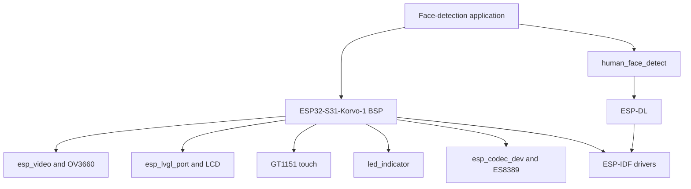

## Assignment 1: Face detection with ESP-DL and the ESP32-S31-Korvo-1 BSP

In this assignment, you will start from the BSP camera example and add local face detection with [ESP-DL](https://github.com/espressif/esp-dl). The OV3660 camera frame, model, inference, and result rendering all remain on the ESP32-S31.

By the end, the LCD will show the live camera stream with a bounding box around each detected face.

> [!TIP]
> The commands in this assignment use the ESP-IDF CLI. As a second option, you can use [Visual Studio Code](https://code.visualstudio.com/) with the [ESP-IDF extension](https://marketplace.visualstudio.com/items?itemName=espressif.esp-idf-extension) to select the `esp32s31` target, open menuconfig, build, flash, and monitor the project.

## Introduction to the ESP32-S31-Korvo-1 BSP

The [`espressif/esp32_s31_korvo_1`](https://components.espressif.com/components/espressif/esp32_s31_korvo_1) component is the official Board Support Package for this board. Version 1.0.1 exposes:

| Capability | Controller or dependency |
|------------|--------------------------|
| Camera | OV3660 through `espressif/esp_video` |
| Display and LVGL | ESP-IDF LCD driver and `espressif/esp_lvgl_port` |
| Touch | GT1151 through `espressif/esp_lcd_touch_gt1151` |
| RGB LED | `espressif/led_indicator` |
| Buttons | `espressif/button` |
| Audio | ES8389 through `espressif/esp_codec_dev` |
| microSD | ESP-IDF SD/MMC |
| USB Host | `espressif/usb` |

The BSP also defines the correct GPIOs, display dimensions, camera rotation, feature flags, and initialization order.

### Why use a BSP?

Without a BSP, an application must duplicate dozens of pin assignments and coordinate the clocks, buses, power controls, and drivers for every peripheral. That code becomes tightly coupled to one board revision.

With the BSP, the application can use calls such as:

```c
bsp_display_start();
bsp_display_backlight_on();
bsp_camera_start(NULL);
```

The advantages are:

- **Less setup code:** a few board-level calls replace low-level bus and pin configuration
- **Known initialization order:** shared resources such as I2C are initialized once
- **Managed dependencies:** the Component Manager resolves compatible camera, display, touch, audio, and LED components
- **Readable intent:** application code says "start camera" instead of configuring each signal
- **Portability:** code built around common ESP-BSP APIs is easier to move to another supported board
- **Maintenance:** pin or driver changes remain inside the BSP instead of spreading through the application

The BSP does not hide every peripheral API. It initializes the board and gives you standard handles when lower-level access is needed.

### BSP architecture and APIs



Some of the APIs available from `bsp/esp-bsp.h` are:

| API | Purpose |
|-----|---------|
| `bsp_camera_start(NULL)` | Initialize the OV3660 and video device |
| `BSP_CAMERA_DEVICE` | V4L2 camera device path |
| `bsp_display_start()` | Initialize the display, touch, and LVGL port |
| `bsp_display_lock()` / `bsp_display_unlock()` | Safely access LVGL objects |
| `bsp_led_indicator_create` | Create handles for the onboard RGB LED |
| `bsp_iot_button_create` | Create button handles |
| `bsp_sdcard_mount()` | Mount the microSD card |
| `bsp_audio_codec_speaker_init()` | Initialize speaker output |

Capability macros such as `BSP_CAPS_CAMERA`, `BSP_CAPS_DISPLAY`, and `BSP_CAPS_SDCARD` let reusable code check whether a board implements a feature.

## Step 1: Verify ESP-IDF

> [!NOTE]
> This workshop assumes that ESP-IDF v6.1 is already installed. If you still need to install it, follow the official [ESP-IDF Getting Started Guide](https://docs.espressif.com/projects/esp-idf/en/v6.1/esp32s31/get-started/index.html), which includes the installation process for Linux, macOS, and Windows.

If you installed ESP-IDF with the [ESP-IDF Installation Manager (EIM)](https://dl.espressif.com/dl/eim/), select and activate v6.1:

```bash
eim list
eim select v6.1
```

Run the activation command printed by EIM, then verify:

```bash
idf.py --version
idf.py --list-targets | grep esp32s31
```

On Windows Command Prompt, replace `grep` with `findstr`.

> [!IMPORTANT]
> Continue only if `esp32s31` appears in the target list. An older ESP-IDF can recognize neither the target nor its toolchain.

## Step 2: Create the project and test the hardware

Create a project from the BSP's camera example:

```bash
idf.py create-project-from-example \
  "espressif/esp32_s31_korvo_1=1.0.1:display_camera_video"
cd display_camera_video
idf.py set-target esp32s31
```

The unmodified example initializes the camera and LCD, captures frames through the V4L2-compatible video API, uses the PPA to fit them to the display, and renders them on an LVGL canvas.

Build the unmodified example first:

```bash
idf.py build
```

Connect the board through the USB Type-C **UART** port, switch it on, and flash the example:

```bash
idf.py -p <PORT> flash monitor
```

The LCD should show the live OV3660 camera stream at 640 × 480 and 10 FPS. Move an object in front of the camera and verify that:

- The displayed image updates continuously.
- The image has the correct orientation.
- No camera or display initialization errors appear in the serial monitor.

This test establishes that the board, camera, LCD subboard, cable, serial port, ESP-IDF installation, and BSP example all work before ESP-DL is added. If the test fails, fix the hardware or environment issue before continuing.

Exit the serial monitor with `Ctrl+]`.

## Step 3: Add the ESP-DL dependencies

Add the face-detection component to `main/idf_component.yml`:

```yaml
dependencies:
  espressif/esp32_s31_korvo_1:
    version: "1.0.1"
  espressif/human_face_detect:
    version: "0.5.0"
```

The `human_face_detect` component brings in ESP-DL 3.3.x and the face model. The model is local: it is linked into the firmware as flash read-only data and does not require a network connection at runtime.

Run reconfigure so the Component Manager downloads and registers the new dependencies:

```bash
idf.py reconfigure
```

## Step 4: Load a local ESP-DL model

The face model is local because inference uses a `.espdl` file stored on the device. It is not downloaded from a server and camera frames are not uploaded for processing.

For this assignment, select **FLASH RODATA**. The Component Manager downloads the model during development, and the ESP-IDF build system links it into the application firmware. After flashing, the model is stored in the ESP32-S31-Korvo-1 module's **16 MB SPI flash**.

This is on-board storage, but it is not the ESP32-S31's internal SRAM. ESP-DL can access the model parameters from memory-mapped flash, while internal SRAM and PSRAM remain available for camera frames, model activations, and application data.

ESP-DL supports three model locations:

| Location | How it works | Advantages | Trade-offs |
|----------|--------------|------------|------------|
| Flash rodata | The model is linked into the application binary and stored in the board's SPI flash | Simplest setup; parameters can remain in memory-mapped flash; one firmware image contains everything | Updating the model requires rebuilding and flashing the application |
| Flash partition | The `.espdl` file is stored in a dedicated data partition named `human_face_det` | The model can be updated separately from the application; useful for OTA model updates | Requires a custom partition table and a separate model-flashing step |
| microSD card | ESP-DL reads the `.espdl` file from a configured directory on the mounted card | Models can be replaced without rebuilding or flashing firmware | Requires a mounted card, increases startup time, and can require PSRAM for model data |

Flash rodata is the best fit for this first native application because it minimizes setup and leaves the model available whenever the firmware boots. The later ESP-Vision assignments use microSD storage to make model swapping faster during experimentation.

Create `main/app_dl.h`:

```c
#pragma once

#include <stdbool.h>
#include <stdint.h>
#include "esp_err.h"

#ifdef __cplusplus
extern "C" {
#endif

esp_err_t app_dl_init(void);
void app_dl_detect_and_draw(uint8_t *buffer, uint32_t width,
                            uint32_t height, bool byte_swapped,
                            bool run_inference);

#ifdef __cplusplus
}
#endif
```

Create `main/app_dl.cpp`:

```cpp
#include "app_dl.h"
#include <algorithm>
#include <list>
#include <new>
#include <vector>
#include "esp_log.h"
#include "human_face_detect.hpp"
#include "dl_image_define.hpp"
#include "dl_image_draw.hpp"

static const char *TAG = "face_detect";
static HumanFaceDetect *s_detector;
static std::list<dl::detect::result_t> s_faces;

extern "C" esp_err_t app_dl_init(void)
{
    s_detector = new (std::nothrow) HumanFaceDetect();
    if (!s_detector) {
        return ESP_ERR_NO_MEM;
    }
    ESP_LOGI(TAG, "Face detector ready; model loads on first inference");
    return ESP_OK;
}

extern "C" void app_dl_detect_and_draw(uint8_t *buffer, uint32_t width,
                                       uint32_t height, bool byte_swapped,
                                       bool run_inference)
{
    if (!s_detector) {
        return;
    }

    dl::image::img_t image = {
        .data = buffer,
        .width = static_cast<uint16_t>(width),
        .height = static_cast<uint16_t>(height),
        .pix_type = byte_swapped
            ? dl::image::DL_IMAGE_PIX_TYPE_RGB565BE
            : dl::image::DL_IMAGE_PIX_TYPE_RGB565LE,
    };

    if (run_inference) {
        s_faces = s_detector->run(image);
    }
    const std::vector<uint8_t> green = byte_swapped
        ? std::vector<uint8_t>{0x07, 0xE0}
        : std::vector<uint8_t>{0xE0, 0x07};

    for (const auto &face : s_faces) {
        int x1 = std::max(0, face.box[0]);
        int y1 = std::max(0, face.box[1]);
        int x2 = std::min(static_cast<int>(width) - 1, face.box[2]);
        int y2 = std::min(static_cast<int>(height) - 1, face.box[3]);
        dl::image::draw_hollow_rectangle(image, x1, y1, x2, y2, green, 3);
        ESP_LOGI(TAG, "face score=%.2f box=[%d,%d,%d,%d]",
                 face.score, x1, y1, x2, y2);
    }
}
```

`HumanFaceDetect` uses the model type and storage location selected by the component's Kconfig. With flash rodata, constructing the wrapper does not copy the model into RAM. By default, the wrapper initializes the selected model lazily on the first `run()`. That call preprocesses the image, executes the quantized network, and returns bounding boxes, confidence scores, and categories. Some detector variants also return keypoints.

> [!NOTE]
> Regardless of storage location, inference still needs working memory for intermediate tensors. Storing parameters in flash avoids copying all model parameters into PSRAM, but it does not eliminate the model's activation-memory requirements.

## Step 5: Capture frames and run inference

Rename `main/main.c` to `main/main.cpp`, then add the ESP-DL source file to `main/CMakeLists.txt`:

```cmake
idf_component_register(
    SRCS "main.cpp" "app_video.c" "app_dl.cpp"
    INCLUDE_DIRS "."
    REQUIRES esp_driver_ppa
)
```

Add the header to `main.cpp`:

```cpp
#include "app_dl.h"
```

In `camera_video_frame_operation()`, run inference before the PPA scales the image for the LCD. Do not run the model on every captured frame.

The camera example is configured for 10 FPS, so a new frame is expected approximately every 100 ms. If face inference takes as long as, or longer than, that interval, processing every frame blocks the capture callback continuously. The display receives fewer updates, frames can be dropped, and interaction appears stalled.

The code below performs inference only when the frame counter is divisible by five:

```text
target inference rate = camera frame rate / frame interval
                      = 10 FPS / 5
                      = approximately 2 inferences per second
```

On the other four frames, `app_dl_detect_and_draw()` skips `s_detector->run()` and redraws the most recent results stored in `s_faces`. Consequently:

- Camera frames can continue reaching the PPA and LVGL between inference runs.
- Bounding boxes remain visible instead of disappearing on skipped frames.
- CPU and memory bandwidth are available for display processing more often.
- Detection positions can lag behind a quickly moving face for several frames.

Five is a starting value, not a universal optimum. A smaller interval updates detections more frequently but increases blocking. A larger interval improves display continuity but makes boxes react more slowly. Measure the selected model's latency and tune the interval for the required user experience.

```cpp
static uint32_t frame_count;

static void camera_video_frame_operation(uint8_t *camera_buf,
        uint8_t camera_buf_index, uint32_t camera_buf_hes,
        uint32_t camera_buf_ves, size_t camera_buf_len)
{
    ++frame_count;
    bool byte_swapped =
        app_video_get_pixelformat() == V4L2_PIX_FMT_RGB565X;
    bool run_inference = frame_count % 5 == 0;
    app_dl_detect_and_draw(camera_buf, camera_buf_hes,
                           camera_buf_ves, byte_swapped,
                           run_inference);

    // Keep the example's existing PPA scaling and LVGL canvas code below.
    // ...
}
```

Finally, initialize the detector in `app_main()` after the BSP starts the camera:

```cpp
bsp_display_start();
bsp_display_backlight_on();
ESP_ERROR_CHECK(bsp_camera_start(NULL));
ESP_ERROR_CHECK(app_dl_init());
```

This first implementation still runs inference synchronously in the frame callback. Frame skipping reduces how often the callback is blocked, but every inference frame still pauses capture until the model finishes. A production application should copy a frame into a PSRAM buffer and run inference in a separate task. The display task can then consume camera frames independently and overlay the latest completed result.

## Step 6: Build, flash, and test

Configure the face model:

```bash
idf.py menuconfig
```

Under **Component config → models: human_face_detect**:

1. Select a face-detection model available for ESP32-S31.
2. Set the model location to **FLASH RODATA**.
3. Save and exit.

Build the project:

```bash
idf.py build
```

Connect the board through the USB Type-C **UART** port, switch it on, and run:

```bash
idf.py -p <PORT> flash monitor
```

Point the camera at a face. The LCD should show a green box and the terminal should print output similar to:

```text
I (4231) face_detect: face score=0.91 box=[126,48,311,267]
```

### Troubleshooting

| Symptom | Check |
|---------|-------|
| `esp32s31` is an unknown target | Install and activate an ESP-IDF release with ESP32-S31 support |
| Camera device does not open | Confirm the camera module is seated and the BSP camera sensor is OV3660 |
| Blank display | Check the LCD subboard connector and call `bsp_display_backlight_on()` |
| Build cannot find `human_face_detect.hpp` | Check `main/idf_component.yml`, then run `idf.py reconfigure` |
| Model does not fit | Select the smaller face model and keep it in flash rodata |
| Low frame rate | Increase the frame-skip interval or move inference to another task |

Exit the serial monitor with `Ctrl+]`.

## Complete working code

The generated `app_video.c` and `app_video.h` files remain unchanged.

<details><summary>Show all changed and new project files</summary>

**`main/idf_component.yml`:**

```yaml
dependencies:
  espressif/esp32_s31_korvo_1:
    version: "1.0.1"
  espressif/human_face_detect:
    version: "0.5.0"
```

**`main/CMakeLists.txt`:**

```cmake
idf_component_register(
    SRCS "main.cpp" "app_video.c" "app_dl.cpp"
    INCLUDE_DIRS "."
    REQUIRES esp_driver_ppa
)
```

**`main/app_dl.h`:**

```c
#pragma once

#include <stdbool.h>
#include <stdint.h>
#include "esp_err.h"

#ifdef __cplusplus
extern "C" {
#endif

esp_err_t app_dl_init(void);
void app_dl_detect_and_draw(uint8_t *buffer, uint32_t width,
                            uint32_t height, bool byte_swapped,
                            bool run_inference);

#ifdef __cplusplus
}
#endif
```

**`main/app_dl.cpp`:**

```cpp
#include "app_dl.h"
#include <algorithm>
#include <list>
#include <new>
#include <vector>
#include "esp_log.h"
#include "human_face_detect.hpp"
#include "dl_image_define.hpp"
#include "dl_image_draw.hpp"

static const char *TAG = "face_detect";
static HumanFaceDetect *s_detector;
static std::list<dl::detect::result_t> s_faces;

extern "C" esp_err_t app_dl_init(void)
{
    s_detector = new (std::nothrow) HumanFaceDetect();
    if (!s_detector) {
        return ESP_ERR_NO_MEM;
    }
    ESP_LOGI(TAG, "Face detector ready; model loads on first inference");
    return ESP_OK;
}

extern "C" void app_dl_detect_and_draw(uint8_t *buffer, uint32_t width,
                                       uint32_t height, bool byte_swapped,
                                       bool run_inference)
{
    if (!s_detector) {
        return;
    }

    dl::image::img_t image = {
        .data = buffer,
        .width = static_cast<uint16_t>(width),
        .height = static_cast<uint16_t>(height),
        .pix_type = byte_swapped
            ? dl::image::DL_IMAGE_PIX_TYPE_RGB565BE
            : dl::image::DL_IMAGE_PIX_TYPE_RGB565LE,
    };

    if (run_inference) {
        s_faces = s_detector->run(image);
    }

    const std::vector<uint8_t> green = byte_swapped
        ? std::vector<uint8_t>{0x07, 0xE0}
        : std::vector<uint8_t>{0xE0, 0x07};

    for (const auto &face : s_faces) {
        int x1 = std::max(0, face.box[0]);
        int y1 = std::max(0, face.box[1]);
        int x2 = std::min(static_cast<int>(width) - 1, face.box[2]);
        int y2 = std::min(static_cast<int>(height) - 1, face.box[3]);
        dl::image::draw_hollow_rectangle(
            image, x1, y1, x2, y2, green, 3);
        ESP_LOGI(TAG, "face score=%.2f box=[%d,%d,%d,%d]",
                 face.score, x1, y1, x2, y2);
    }
}
```

**`main/main.cpp`:**

```cpp
#include <cassert>
#include <cstdint>
#include <cstdio>
#include <cstring>
#include <fcntl.h>
#include <sys/ioctl.h>
#include <unistd.h>
#include <linux/videodev2.h>

#include "sdkconfig.h"
#include "bsp/esp-bsp.h"
#include "esp_err.h"
#include "esp_log.h"
#include "esp_private/esp_cache_private.h"
#include "app_video.h"
#include "app_dl.h"

#if SOC_PPA_SUPPORTED
#include "driver/ppa.h"
#endif

#define NUM_BUFS 2
#define ALIGN_UP(num, align) \
    (((num) + ((align) - 1)) & ~((align) - 1))

static const char *TAG = "camera_face_detect";

#if SOC_PPA_SUPPORTED
static ppa_client_handle_t s_ppa_handle;
#endif

static size_t s_cache_line_size;
static lv_obj_t *s_camera_canvas;
static uint8_t *s_camera_buffers[NUM_BUFS];
static uint32_t s_camera_buffer_size;
static lv_color_format_t s_lvgl_rgb565_format;
static uint32_t s_frame_count;

static lv_color_format_t lvgl_rgb565_format_from_v4l2(
    uint32_t pixel_format)
{
    if (pixel_format == V4L2_PIX_FMT_RGB565X) {
        return LV_COLOR_FORMAT_RGB565_SWAPPED;
    }
    if (pixel_format == V4L2_PIX_FMT_RGB565) {
        return LV_COLOR_FORMAT_RGB565;
    }
    ESP_LOGW(TAG, "Unexpected RGB565 format; using RGB565");
    return LV_COLOR_FORMAT_RGB565;
}

#if SOC_PPA_SUPPORTED
static void app_ppa_init(void)
{
    ppa_client_config_t config = {
        .oper_type = PPA_OPERATION_SRM,
    };
    ESP_ERROR_CHECK(ppa_register_client(&config, &s_ppa_handle));
}

static esp_err_t scale_and_rotate(
    uint8_t *input, uint32_t input_width, uint32_t input_height,
    uint8_t *output, uint32_t output_width, uint32_t output_height,
    size_t output_size, ppa_srm_rotation_angle_t rotation)
{
    float scale_x = static_cast<float>(output_width) / input_width;
    float scale_y = static_cast<float>(output_height) / input_height;

    if (rotation == PPA_SRM_ROTATION_ANGLE_90 ||
            rotation == PPA_SRM_ROTATION_ANGLE_270) {
        scale_x = static_cast<float>(output_height) / input_width;
        scale_y = static_cast<float>(output_width) / input_height;
    }

    ppa_srm_oper_config_t config = {
        .in.buffer = input,
        .in.pic_w = input_width,
        .in.pic_h = input_height,
        .in.block_w = input_width,
        .in.block_h = input_height,
        .in.block_offset_x = 0,
        .in.block_offset_y = 0,
        .in.srm_cm = PPA_SRM_COLOR_MODE_RGB565,
        .out.buffer = output,
        .out.buffer_size = output_size,
        .out.pic_w = output_width,
        .out.pic_h = output_height,
        .out.block_offset_x = 0,
        .out.block_offset_y = 0,
        .out.srm_cm = PPA_SRM_COLOR_MODE_RGB565,
        .rotation_angle = rotation,
        .scale_x = scale_x,
        .scale_y = scale_y,
        .rgb_swap = 0,
        .byte_swap = 0,
        .mode = PPA_TRANS_MODE_BLOCKING,
    };

    return ppa_do_scale_rotate_mirror(s_ppa_handle, &config);
}

static void calculate_aspect_fit(
    uint32_t source_width, uint32_t source_height,
    uint32_t destination_width, uint32_t destination_height,
    uint32_t *output_width, uint32_t *output_height)
{
    float source_aspect =
        static_cast<float>(source_width) / source_height;
    float destination_aspect =
        static_cast<float>(destination_width) / destination_height;

    if (source_aspect > destination_aspect) {
        *output_width = destination_width;
        *output_height =
            static_cast<uint32_t>(destination_width / source_aspect);
    } else {
        *output_height = destination_height;
        *output_width =
            static_cast<uint32_t>(destination_height * source_aspect);
    }
}
#endif

static void camera_frame_operation(
    uint8_t *camera_buffer, uint8_t buffer_index,
    uint32_t width, uint32_t height, size_t buffer_length)
{
    (void)buffer_length;

    ++s_frame_count;
    bool byte_swapped =
        app_video_get_pixelformat() == V4L2_PIX_FMT_RGB565X;
    bool run_inference = s_frame_count % 5 == 0;
    app_dl_detect_and_draw(
        camera_buffer, width, height, byte_swapped, run_inference);

    uint32_t output_width = width;
    uint32_t output_height = height;
    uint8_t *output_buffer = camera_buffer;

#if SOC_PPA_SUPPORTED
    ppa_srm_rotation_angle_t rotation = PPA_SRM_ROTATION_ANGLE_0;

    switch (BSP_CAMERA_ROTATION) {
    case 90:
        rotation = PPA_SRM_ROTATION_ANGLE_90;
        break;
    case 180:
        rotation = PPA_SRM_ROTATION_ANGLE_180;
        break;
    case 270:
        rotation = PPA_SRM_ROTATION_ANGLE_270;
        break;
    default:
        break;
    }

    if (BSP_CAMERA_ROTATION == 90 || BSP_CAMERA_ROTATION == 270) {
        calculate_aspect_fit(
            height, width, BSP_LCD_H_RES, BSP_LCD_V_RES,
            &output_width, &output_height);
    } else {
        calculate_aspect_fit(
            width, height, BSP_LCD_H_RES, BSP_LCD_V_RES,
            &output_width, &output_height);
    }

    ESP_ERROR_CHECK(scale_and_rotate(
        camera_buffer, width, height,
        s_camera_buffers[buffer_index],
        output_width, output_height,
        s_camera_buffer_size, rotation));
    output_buffer = s_camera_buffers[buffer_index];
#endif

    bsp_display_lock(0);
    lv_canvas_set_buffer(
        s_camera_canvas, output_buffer,
        output_width, output_height,
        s_lvgl_rgb565_format);
    lv_obj_center(s_camera_canvas);
    lv_obj_invalidate(s_camera_canvas);
    bsp_display_unlock();
}

extern "C" void app_main(void)
{
    bsp_display_start();
    bsp_display_backlight_on();
    ESP_ERROR_CHECK(bsp_camera_start(NULL));
    ESP_ERROR_CHECK(app_dl_init());

#if SOC_PPA_SUPPORTED
    app_ppa_init();
#endif

    ESP_ERROR_CHECK(esp_cache_get_alignment(
        MALLOC_CAP_SPIRAM, &s_cache_line_size));

    s_camera_buffer_size = ALIGN_UP(
        BSP_LCD_H_RES * BSP_LCD_V_RES * 2, s_cache_line_size);

    for (int index = 0; index < NUM_BUFS; ++index) {
        s_camera_buffers[index] = static_cast<uint8_t *>(
            heap_caps_aligned_calloc(
                s_cache_line_size, 1, s_camera_buffer_size,
                MALLOC_CAP_SPIRAM));
        ESP_ERROR_CHECK(
            s_camera_buffers[index] ? ESP_OK : ESP_ERR_NO_MEM);
    }

    int video_fd = app_video_open(
        BSP_CAMERA_DEVICE, APP_VIDEO_FMT_DRIVER_DEFAULT);
    ESP_ERROR_CHECK(video_fd < 0 ? ESP_FAIL : ESP_OK);

    s_lvgl_rgb565_format = lvgl_rgb565_format_from_v4l2(
        app_video_get_pixelformat());

    bsp_display_lock(0);
    s_camera_canvas = lv_canvas_create(lv_screen_active());
    lv_canvas_set_buffer(
        s_camera_canvas, s_camera_buffers[0],
        BSP_LCD_H_RES, BSP_LCD_V_RES,
        s_lvgl_rgb565_format);
    assert(s_camera_canvas);
    lv_obj_center(s_camera_canvas);
    bsp_display_unlock();

    ESP_ERROR_CHECK(app_video_set_bufs(video_fd, NUM_BUFS, NULL));
    ESP_ERROR_CHECK(app_video_register_frame_operation_cb(
        camera_frame_operation));
    ESP_ERROR_CHECK(app_video_stream_task_start(video_fd, 0));

    ESP_LOGI(TAG, "Camera and face detection running");
}
```

</details>

## What you will see

After the application starts:

- The 4.3-inch LCD shows the live OV3660 camera stream.
- A green bounding box appears around each detected face.
- The box remains visible between inference frames by reusing the latest detection result.
- The serial monitor reports each detection's confidence score and bounding-box coordinates.
- A moving face may briefly move ahead of its box because inference runs every fifth camera frame.

When no face is detected, the display continues showing the live camera stream without a bounding box.

## What you learned

In this assignment, you:

- Used the ESP32-S31-Korvo-1 BSP instead of configuring camera and display pins manually
- Learned how the BSP improves portability, dependency management, and maintainability
- Added the ESP-DL face-detection component to an ESP-IDF project
- Loaded a model locally from flash and ran inference without a cloud service
- Drew detection results on frames before displaying them

## Next step

[Assignment 2: Getting started with ESP-Vision](../assignment-2)

[Return to the workshop main page](/workshops/introduction-to-esp32-s31-with-vision/)
