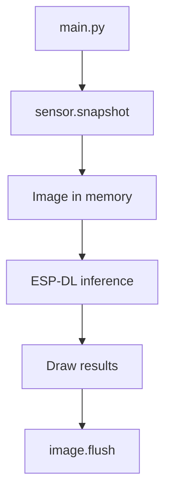

## Assignment 2: Getting started with ESP-Vision



[ESP-Vision](https://vision.espressif.com/en) is a rapid-development environment for camera and edge-AI applications on Espressif hardware. It combines an ESP32 build of MicroPython with high-level camera, image, display, and inference modules.

In this assignment, you will flash ESP-Vision and connect the ESP32-S31-Korvo-1 to either the Web IDE or the ESP-Vision extension for Visual Studio Code. The first Python application comes after the LED Blink assignment.

> [!TIP]
> The Web IDE requires no installation and is the quickest way to begin. The Visual Studio Code extension provides the same edit, run, stop, preview, example, and device-file workflow inside a desktop editor.

## How ESP-Vision works

ESP-Vision code runs **on the SoC**, not on your computer. It is MicroPython rather than desktop CPython, so desktop packages, native wheels, `pip`, and operating-system services are not available on the device.

The ESP32-S31 build provides these principal modules:

| Module | Purpose |
|--------|---------|
| `sensor` | Configure the OV3660 and capture frames |
| `image` | Draw, filter, transform, and analyze images |
| `display` | Control the board LCD |
| `espdl` | Load and execute `.espdl` models |
| `tflite` | Execute supported TensorFlow Lite Micro models |
| `imageio` | Read and write supported image sequences |

The typical loop is:

Scripts and model files are separate. A script can be edited quickly, while a large model remains on the microSD card.

## Step 1: Flash ESP-Vision

> [!WARNING]
> The USB Type-C **UART** port is not available for the ESP-Vision development workflow. Connect the computer to the board's USB Type-A **USB CDC/JTAG/Debug** port with a data-capable USB Type-A to Type-A cable. Both development environments use this faster native USB connection because transferring the live camera preview over UART is too slow.

1. Connect a data-capable USB Type-A to Type-A cable between your computer and the board's USB Type-A **USB CDC/JTAG/Debug** port.
2. Insert a FAT32-formatted microSD card.
3. Turn the board on.
4. Open [vision.espressif.com](https://vision.espressif.com/en) in a Chromium-based browser.
5. Select **Flash It Now**.



6. Choose **ESP32-S31-Korvo-1** and the current stable ESP-Vision firmware.



7. Select **Connect Serial**.
8. Choose the USB CDC/JTAG/Debug device associated with the ESP32-S31-Korvo-1, and then select **Connect**.



9. Start flashing and wait until the operation completes. Do not disconnect or power off the board while firmware is being written.



If the browser cannot start the download, put the board into download mode:

1. Hold **Boot**.
2. Press and release **Reset**.
3. Release **Boot**.
4. Retry the web flasher.

> [!IMPORTANT]
> Flashing replaces the native ESP-IDF application from Assignment 1. You can restore it later with `idf.py flash`.

## Step 2: Connect to the board

Close serial monitors and other applications first; only one application can own the USB CDC/JTAG/Debug device at a time. Then choose one of the following development environments.


  

1. Open the **Web IDE** from [vision.espressif.com](https://vision.espressif.com/en).
2. Select **Connect**.
3. Choose the ESP32-S31-Korvo-1 USB CDC/JTAG/Debug device.



4. Stop any script that starts automatically.
5. Open the device **REPL (Read-Evaluate-Print Loop)**. The REPL is MicroPython's interactive console: it reads a command, evaluates it on the ESP32-S31, prints the result, and waits for the next command. It is useful for checking the connection, trying short API calls, and viewing script output or errors.

The connection is ready when the Web IDE reports the device as connected and the REPL displays the MicroPython prompt (`>>>`).

> [!TIP]
> The IDE camera preview is especially useful when your development board or setup does not include an LCD. It lets you inspect live camera frames directly on your computer while developing and debugging the application. The preview also includes an RGB color histogram for examining the distribution of red, green, and blue values in each frame.



  
  

1. Install [Visual Studio Code](https://code.visualstudio.com/).
2. Download the official [ESP-Vision extension for Visual Studio Code](https://dl.espressif.com/AE/esp-vision/vscode/esp-vision-0.1.0.vsix).
3. Open the **Extensions** view in Visual Studio Code.
4. Open the **More Actions** menu (`...`) and select **Install from VSIX...**.
5. Select the downloaded `esp-vision-0.1.0.vsix` file.
6. Open the Command Palette and run **ESP-VISION: Connect**.
7. Choose the ESP32-S31-Korvo-1 USB CDC/JTAG/Debug device.

The connection is ready when Visual Studio Code reports that ESP-Vision is connected and the ESP-Vision activity-bar views populate.

You can also use:

- **ESP-VISION: Stop Script** to stop a running program
- **ESP-VISION: Soft Reset** to restart MicroPython
- **ESP-VISION: Show Preview** to open the live camera preview
- **ESP-VISION: Open Example** to browse bundled examples

  


## Step 3: Explore the development workflow

ESP-Vision applications normally follow this cycle:

1. **Edit** a script in the Web IDE or Visual Studio Code.
2. **Save** it locally or to the device filesystem.
3. **Run** it and observe the preview and device output.
4. **Stop** it before replacing the file or opening another transport.
5. Review exceptions from the bottom upward; the final line gives the exception type and message.

Use `main.py` only when you want a script to run automatically at boot. During development, use a separate filename so a faulty infinite loop does not restart after every reset.

In Visual Studio Code, the ESP-Vision activity-bar view also provides access to bundled examples, the API library reference, and files on the mounted ESP-Vision flash disk.

### Common problems

| Symptom | Resolution |
|---------|------------|
| No ESP-Vision device appears | Use a data-capable USB Type-A to Type-A cable and the board's USB Type-A USB CDC/JTAG/Debug port |
| Port is busy | Disconnect the other Web IDE or Visual Studio Code session, and close `idf.py monitor` or any serial terminal |
| Script cannot import a desktop package | Use only firmware modules or copy a compatible pure-Python module to `/lib` |

## What you learned

In this assignment, you:

- Used ESP-Vision on the ESP32-S31-Korvo-1
- Learned the difference between device-side MicroPython and desktop Python
- Flashed the ESP-Vision firmware through the browser
- Connected with the Web IDE or Visual Studio Code extension
- Explored the edit, run, stop, preview, example, and device-file workflow

## Next step

[Assignment 3: Set up the ESP-Vision MCP server](../assignment-3)

[Return to the workshop main page](/workshops/introduction-to-esp32-s31-with-vision/)
