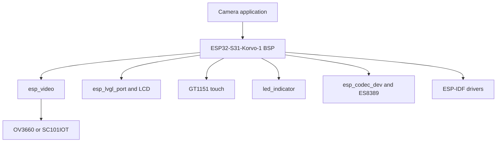

## Move from rapid prototyping to native development

In the previous assignments, ESP-Vision provided a fast way to develop and test vision applications. Its browser-based workflow and high-level Python APIs made it possible to capture images, run inference, draw results, and control the board without first creating a complete native firmware project.

For some applications, however, you need the lower-level control, configuration options, performance, and native component integration provided by ESP-IDF. The remaining assignments introduce this workflow using:

- **ESP-IDF** to configure, build, flash, and debug the firmware
- **ESP-BSP** to initialize and access the ESP32-S31-Korvo-1 hardware
- **ESP-DL** to run optimized neural-network inference

In this assignment, you will start that transition by creating and running the ESP32-S31-Korvo-1 BSP camera example. Testing the unmodified example first confirms that ESP-IDF, the board, the installed camera sensor, the LCD, and the UART connection work before ESP-DL is added in the final assignment.

The ESP32-S31-Korvo-1 can ship with either an **OV3660** or **SC101IOT** DVP camera. The camera stack uses `esp_video` to detect the installed sensor at runtime.

> [!TIP]
> The commands use the ESP-IDF CLI. You can alternatively use [Visual Studio Code](https://code.visualstudio.com/) with the [ESP-IDF extension](https://marketplace.visualstudio.com/items?itemName=espressif.esp-idf-extension).

## The ESP32-S31-Korvo-1 BSP

The [`espressif/esp32_s31_korvo_1`](https://components.espressif.com/components/espressif/esp32_s31_korvo_1) component is the official Board Support Package for the board. It provides:

| Capability | Controller or dependency |
|------------|--------------------------|
| Camera | OV3660 or SC101IOT through `espressif/esp_video` |
| Display and LVGL | ESP-IDF LCD driver and `espressif/esp_lvgl_port` |
| Touch | GT1151 through `espressif/esp_lcd_touch_gt1151` |
| RGB LED | `espressif/led_indicator` |
| Buttons | `espressif/button` |
| Audio | ES8389 through `espressif/esp_codec_dev` |
| microSD | ESP-IDF SD/MMC |
| USB Host | `espressif/usb` |

The BSP defines the board GPIOs, display dimensions, camera rotation, feature flags, and peripheral initialization order.

### Why use a BSP?

Without a BSP, an application must duplicate pin assignments and coordinate clocks, buses, power controls, and drivers for every peripheral. That code becomes tightly coupled to one board revision.

With the BSP, the application can use board-level calls:

```c
bsp_display_start();
bsp_display_backlight_on();
bsp_camera_start(NULL);
```

The advantages are:

- **Less setup code:** board-level calls replace low-level bus and pin configuration
- **Known initialization order:** shared resources such as I2C are initialized once
- **Managed dependencies:** the Component Manager resolves compatible peripheral components
- **Readable intent:** application code states which board feature it starts
- **Portability:** common ESP-BSP APIs make migration to another supported board easier
- **Maintenance:** board-specific changes remain in the BSP

The BSP initializes the board and provides standard handles when lower-level access is needed.

### BSP architecture and APIs



Some APIs available from `bsp/esp-bsp.h` are:

| API | Purpose |
|-----|---------|
| `bsp_camera_start(NULL)` | Initialize and detect the installed camera |
| `BSP_CAMERA_DEVICE` | V4L2 camera device path |
| `bsp_display_start()` | Initialize the display, touch, and LVGL port |
| `bsp_display_lock()` / `bsp_display_unlock()` | Safely access LVGL objects |
| `bsp_led_indicator_create` | Create handles for the onboard RGB LED |
| `bsp_iot_button_create` | Create button handles |
| `bsp_sdcard_mount()` | Mount an optional microSD card |
| `bsp_audio_codec_speaker_init()` | Initialize speaker output |

Capability macros such as `BSP_CAPS_CAMERA`, `BSP_CAPS_DISPLAY`, and `BSP_CAPS_SDCARD` let reusable code check whether the board implements a feature.

## Step 1: Verify ESP-IDF

> [!NOTE]
> This workshop requires ESP-IDF v6.1 or later. Version v6.1 is recommended because the instructions and examples were tested with that release. If needed, follow the official [ESP-IDF Getting Started Guide](https://docs.espressif.com/projects/esp-idf/en/v6.1/esp32s31/get-started/index.html).

If ESP-IDF was installed with the [ESP-IDF Installation Manager](https://dl.espressif.com/dl/eim/), select and activate v6.1:

```bash
eim list
eim select v6.1
```

Verify the active installation:

```bash
idf.py --version
idf.py --list-targets | grep esp32s31
```

The first command must report ESP-IDF v6.1 or later. If it reports v5.x or an older release, activate or install a supported version before continuing. The second command confirms that the active installation includes the `esp32s31` target.

On Windows Command Prompt, replace `grep` with `findstr`.

For Visual Studio Code, run **ESP-IDF: Doctor Command**, confirm that the report points to ESP-IDF v6.1 or later, and use **ESP-IDF: Open ESP-IDF Terminal** to run the same verification commands.

> [!IMPORTANT]
> Continue only if the active ESP-IDF version is v6.1 or later and `esp32s31` appears in the target list.

## Step 2: Create the BSP project


  

Create the project from the BSP example:

```bash
idf.py create-project-from-example \
  "espressif/esp32_s31_korvo_1=1.0.1:display_camera_video"
cd display_camera_video
idf.py set-target esp32s31
```

  
  

1. Open the Command Palette.
2. Run **ESP-IDF: Show ESP Component Registry**.
3. Search for `esp32_s31_korvo_1`.
4. Open `espressif/esp32_s31_korvo_1` and select version **1.0.1**.
5. Find `display_camera_video` and select **Create project from this example**.
6. Choose a destination, create the project, and open it.
7. Run **ESP-IDF: Set Espressif Device Target** and select `esp32s31`.

See the official [project-creation guide](https://docs.espressif.com/projects/vscode-esp-idf-extension/en/latest/startproject.html#esp-component-registry) for more information.

  


The example captures frames through the V4L2-compatible video API, uses the PPA to fit them to the display, and renders them on an LVGL canvas.

## Step 3: Build, flash, and test the hardware

Connect the board through the USB Type-C **UART** port.


  

```bash
idf.py build
idf.py -p <PORT> flash monitor
```

  
  

1. Run **ESP-IDF: Select Port to Use (COM, tty, usbserial)** and select the UART port.
2. Run **ESP-IDF: Build, Flash and Start a Monitor on Your Device**.
3. Select **UART** as the flash method.
4. Wait for the serial monitor to open.

  


The LCD should show the live camera stream. The example normally uses 640 × 480 at 10 FPS, subject to the formats supported by the detected sensor. Verify that:

- The displayed image updates continuously.
- The image has the correct orientation.
- The serial monitor identifies the installed camera without initialization errors.
- The LCD initializes without errors.

This test establishes that the board, camera, LCD subboard, cable, ESP-IDF installation, and BSP all work before ESP-DL is added.

Exit the serial monitor with `Ctrl+]`.

## What you will see

- A live image from the installed OV3660 or SC101IOT on the 4.3-inch LCD
- Camera and display initialization messages in the serial monitor
- Automatic detection of the installed camera sensor

## What you learned

In this assignment, you:

- Used the ESP32-S31-Korvo-1 BSP instead of hardcoded board configuration
- Created a project from a Component Registry example
- Tested the camera and LCD before adding inference
- Used either the ESP-IDF CLI or ESP-IDF extension workflow

## Next step

[Assignment 7: Face detection with ESP-DL](../assignment-7)

[Return to the workshop main page](/workshops/introduction-to-esp32-s31-with-vision/)
