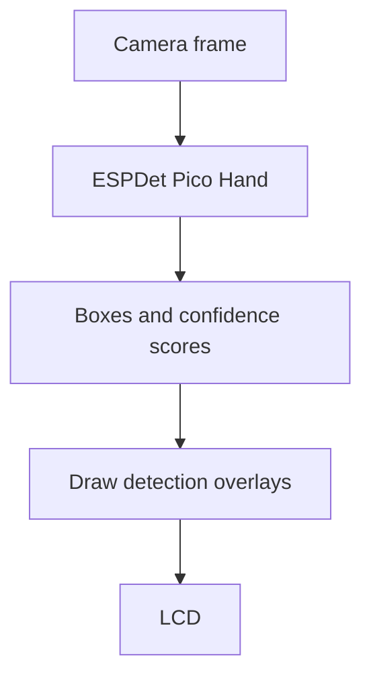

## Assignment 6: Hand detection with ESPDet

In this assignment, you will run an ESPDet Pico hand-detection model on live camera frames. The application draws a rectangle and confidence score around each detected hand and displays the annotated image on the ESP32-S31-Korvo-1 LCD.

This application performs detection, not tracking. Each frame is processed independently, so detections do not receive persistent IDs.

> [!TIP]
> You can edit, upload, and run `hand_detection.py` with the ESP-Vision Web IDE or with the ESP-Vision extension for [Visual Studio Code](https://code.visualstudio.com/) available from the [ESP-Vision website](https://vision.espressif.com/en). These tools are used only to manage the script and view logs; the camera image is rendered on the board LCD.

> [!IMPORTANT]
> This application uses `lcd.write(image)`, not `image.flush()`. The annotated camera frames appear on the ESP32-S31-Korvo-1 LCD rather than in the IDE preview.

## Hand-detection pipeline

<div style="display: flex; justify-content: center;">



</div>

`espdl.ESPDet` performs image preprocessing, inference, and model-specific output decoding. It returns one tuple for each detection that passes the score and non-maximum suppression thresholds:

```text
(x, y, width, height, score, category)
```

The first four values define the bounding box. `score` describes the model's confidence, and `category` identifies the detected class.

## Step 1: Prepare the hand-detection model

Download the ESP32-S31 build of the **ESPDet Pico Hand 224 × 224** model from the model collection on the [ESP-Vision website](https://vision.espressif.com/en). Copy it to the root of the FAT32-formatted microSD card with this filename:

```text
espdet_pico_224_224_hand.espdl
```

Insert the microSD card before starting ESP-Vision. The mounted model path will be:

```text
/sdcard/espdet_pico_224_224_hand.espdl
```

In the REPL, verify that the file is available:

```python
import os
print(os.listdir("/sdcard"))
```

> [!IMPORTANT]
> Use a model distributed or exported for ESP32-S31. A model built for another target may fail to load or produce incorrect results.

## Step 2: Configure the application

Create `hand_detection.py` and import the camera, display, inference, and timing modules:

```python
import display
import espdl
import sensor
import time
```

Define the model path and detection thresholds:

```python
MODEL = "/sdcard/espdet_pico_224_224_hand.espdl"
SCORE_THRESHOLD = 0.5
NMS_THRESHOLD = 0.7
BOX_COLOR = (255, 0, 0)
```

- `SCORE_THRESHOLD` discards detections with a confidence score below 0.5.
- `NMS_THRESHOLD` controls when overlapping candidate boxes are considered duplicates.
- `BOX_COLOR` draws red boxes and labels in RGB order.

These values are starting points. Lowering the score threshold can recover difficult detections but may increase false positives. See [Lecture 2](../lecture-2#score-and-nms-thresholds) for additional details.

## Step 3: Initialize the camera, LCD, and model

Initialize the LCD and configure the camera for 320 × 240 RGB frames:

```python
lcd = display.Display()

sensor.reset()
sensor.set_pixformat(sensor.RGB565)
sensor.set_framesize(sensor.QVGA)
sensor.skip_frames(time=1000)
```

Create the detector once, before the frame loop:

```python
detector = espdl.ESPDet(
    MODEL,
    score=SCORE_THRESHOLD,
    nms=NMS_THRESHOLD,
)
```

Constructing the model outside the loop avoids repeatedly loading it and allocating inference resources.

## Step 4: Detect and display hands

Capture a frame and pass it to the detector:

```python
image = sensor.snapshot()
detections = detector.detect(image)
```

Draw each returned bounding box and confidence score:

```python
for x, y, width, height, score, _category in detections:
    image.draw_rectangle(
        x,
        y,
        width,
        height,
        color=BOX_COLOR,
        thickness=2,
    )
    image.draw_string(
        x,
        max(0, y - 12),
        "hand %.2f" % score,
        color=BOX_COLOR,
    )
```

The label is placed above the box when space is available. `max(0, y - 12)` prevents the text coordinate from moving above the image boundary.

Write the annotated frame to the LCD and briefly yield before capturing the next frame:

```python
lcd.write(image)
time.sleep_ms(20)
```

## Step 5: Run and evaluate


  

1. Connect the ESP-Vision Web IDE to the board.
2. Create `hand_detection.py`.
3. Paste the complete code and save it to the device.
4. Select **Run**.
5. Observe the LCD and REPL output.

  
  

1. Connect with **ESP-VISION: Connect**.
2. Create and open `hand_detection.py`.
3. Paste and save the complete code.
4. Run **ESP-VISION: Run Current File**.
5. Observe the board LCD and ESP-Vision output.

  


Test these conditions:

| Test | Expected behavior |
|------|-------------------|
| No hand | No detection box |
| One visible hand | One red box and confidence score |
| Two separated hands | A box around each detected hand |
| Partially hidden hand | Detection may become less confident or disappear |
| Poor lighting or fast movement | Detection may flicker because of blur or low contrast |

If detections are unreliable:

- Improve front lighting and reduce motion blur.
- Keep the full hand visible and within the camera frame.
- Move the hand closer if it occupies very few pixels.
- Lower `SCORE_THRESHOLD` gradually, for example from 0.5 to 0.4, while checking for false positives.
- Confirm that the model file is the ESP32-S31 hand-detection model.

## Complete working code

<details><summary>Show the complete hand_detection.py</summary>

```python
# SPDX-FileCopyrightText: 2026 Espressif Systems (Shanghai) CO LTD
# SPDX-License-Identifier: Apache-2.0

import display
import espdl
import sensor
import time

MODEL = "/sdcard/espdet_pico_224_224_hand.espdl"
SCORE_THRESHOLD = 0.5
NMS_THRESHOLD = 0.7
BOX_COLOR = (255, 0, 0)

lcd = display.Display()

sensor.reset()
sensor.set_pixformat(sensor.RGB565)
sensor.set_framesize(sensor.QVGA)
sensor.skip_frames(time=1000)

detector = espdl.ESPDet(
    MODEL,
    score=SCORE_THRESHOLD,
    nms=NMS_THRESHOLD,
)

try:
    while True:
        image = sensor.snapshot()

        detections = detector.detect(image)

        for x, y, width, height, score, _category in detections:
            image.draw_rectangle(
                x,
                y,
                width,
                height,
                color=BOX_COLOR,
                thickness=2,
            )
            image.draw_string(
                x,
                max(0, y - 12),
                "hand %.2f" % score,
                color=BOX_COLOR,
            )

        lcd.write(image)
        time.sleep_ms(20)
finally:
    detector.deinit()
    sensor.shutdown()
    lcd.deinit()
```

</details>

## What you will see

- A live 320 × 240 camera image on the ESP32-S31-Korvo-1 LCD.
- A red rectangle around each detected hand.
- A `hand` label and confidence score above each box.
- Boxes that update independently on every frame.

## What you learned

In this assignment, you:

- Loaded an ESP32-S31-compatible ESPDet Pico hand model from microSD
- Configured score and NMS thresholds
- Interpreted detector boxes, scores, and categories
- Drew detection results on live camera frames
- Displayed annotated frames on the board LCD
- Released model, camera, and display resources when the script stops

## Next step

[Assignment 7: Add a safety zone](../assignment-7)

[Return to the workshop main page](/workshops/introduction-to-esp32-s31-with-vision/)
