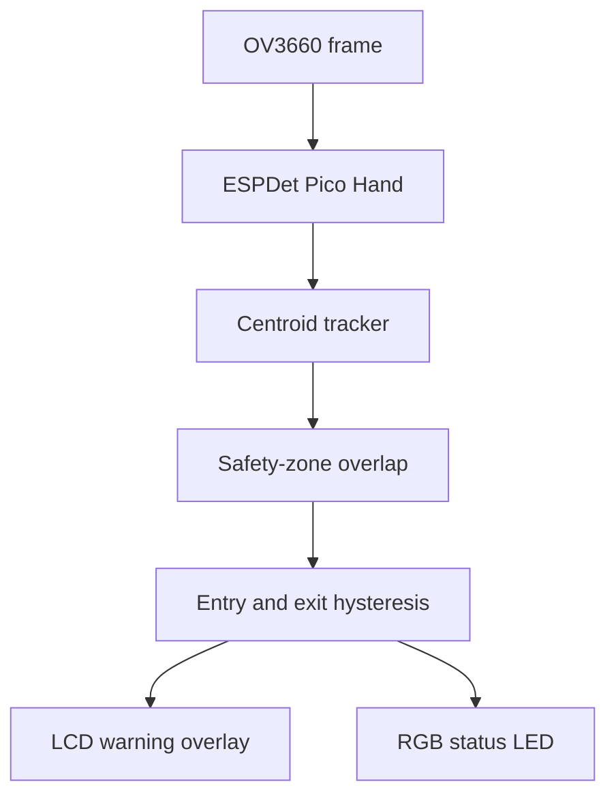

## Assignment 8: Keep hands off!

This final assignment combines camera capture, local inference, tracking, overlap detection, display overlays, and the RGB LED.

The application meets these workshop acceptance criteria:

- Camera frames and inference remain local.
- Each detected hand has a track ID.
- A protected region is visible on the LCD.
- A persistent intrusion turns the zone and RGB LED red.
- The warning does not flicker on one-frame detection changes.
- Stopping the script releases the model, camera, LCD, and LED.

> [!TIP]
> You can assemble and test the final application in the ESP-Vision Web IDE or use the ESP-Vision extension for [Visual Studio Code](https://code.visualstudio.com/) available from the [ESP-Vision website](https://vision.espressif.com/en). The development environment manages the script and logs; the annotated camera image appears on the board LCD.

> [!WARNING]
> This is an educational presence-warning demo, not a safety-certified control. Do not use it as the only protective measure around hazardous equipment.

## Application architecture



Detection answers where hands are now. Tracking stabilizes identity. The overlap function turns geometry into a raw intrusion signal. Hysteresis then converts that noisy frame-by-frame signal into application state.

## Step 1: Integrate the application

Copy `safety_zone.py` from Assignment 7 to a new file named `keep_hands_off.py`. Add the LED and warning-hysteresis definitions while retaining the detector, tracker, overlap calculation, and normalized zone:

```python
from machine import Pin, bitstream
import display
import espdl
import sensor
import time


MODEL = "/sdcard/espdet_pico_224_224_hand.espdl"
LED_PIN = 37
SCORE = 0.5
NMS = 0.7

ZONE_X = 0.60
ZONE_Y = 0.15
ZONE_WIDTH = 0.30
ZONE_HEIGHT = 0.70
MIN_OVERLAP = 0.15

MAX_DISTANCE_SQ = 80 * 80
MAX_MISSED = 3
ENTER_FRAMES = 2
EXIT_FRAMES = 5

GREEN = (0, 24, 0)
RED = (32, 0, 0)
OFF = (0, 0, 0)
WS2812_TIMING = (400, 850, 800, 450)


def set_led(pin, color):
    red, green, blue = color
    bitstream(pin, 0, WS2812_TIMING, bytes((green, red, blue)))
    time.sleep_us(80)


def make_zone(frame):
    return (
        int(frame.width() * ZONE_X),
        int(frame.height() * ZONE_Y),
        int(frame.width() * ZONE_WIDTH),
        int(frame.height() * ZONE_HEIGHT),
    )


def center(detection):
    x, y, w, h, score, category = detection
    return x + w // 2, y + h // 2


def update_tracks(detections, tracks, next_id):
    updated = {}
    used_ids = set()
    output = []

    for detection in detections:
        cx, cy = center(detection)
        best_id = None
        best_distance = MAX_DISTANCE_SQ + 1

        for track_id, state in tracks.items():
            if track_id in used_ids:
                continue
            px, py, missed = state
            distance = (cx - px) ** 2 + (cy - py) ** 2
            if distance < best_distance:
                best_id = track_id
                best_distance = distance

        if best_id is None or best_distance > MAX_DISTANCE_SQ:
            best_id = next_id
            next_id += 1

        used_ids.add(best_id)
        updated[best_id] = (cx, cy, 0)
        output.append((best_id, detection))

    for track_id, state in tracks.items():
        if track_id in used_ids:
            continue
        px, py, missed = state
        if missed < MAX_MISSED:
            updated[track_id] = (px, py, missed + 1)

    return output, updated, next_id


def overlap_ratio(hand, zone):
    hx, hy, hw, hh, score, category = hand
    zx, zy, zw, zh = zone
    left = max(hx, zx)
    top = max(hy, zy)
    right = min(hx + hw, zx + zw)
    bottom = min(hy + hh, zy + zh)
    intersection = max(0, right - left) * max(0, bottom - top)
    return intersection / max(1, hw * hh)


def update_warning(raw_intrusion, warning, enter_count, exit_count):
    if raw_intrusion:
        enter_count += 1
        exit_count = 0
        if enter_count >= ENTER_FRAMES:
            warning = True
    else:
        enter_count = 0
        exit_count += 1
        if exit_count >= EXIT_FRAMES:
            warning = False
    return warning, enter_count, exit_count
```

This contains no project-specific helper modules, so the device needs only this script and the model file.

## Step 2: Add visual and LED warnings

Append the application:

```python
def main():
    led = Pin(LED_PIN, Pin.OUT)
    detector = None
    lcd = None
    tracks = {}
    next_id = 1
    warning = False
    enter_count = 0
    exit_count = EXIT_FRAMES
    last_led_state = None

    sensor.reset()
    try:
        lcd = display.Display()
        sensor.set_pixformat(sensor.RGB565)
        sensor.set_framesize(sensor.QVGA)
        sensor.skip_frames(time=1000)
        detector = espdl.ESPDet(MODEL, score=SCORE, nms=NMS)
        print("HANDS_OFF:READY")

        while True:
            frame = sensor.snapshot()
            zone = make_zone(frame)
            detections = detector.detect(frame)
            tracked, tracks, next_id = update_tracks(
                detections, tracks, next_id)

            raw_intrusion = False
            states = []
            for track_id, detection in tracked:
                ratio = overlap_ratio(detection, zone)
                inside = ratio >= MIN_OVERLAP
                raw_intrusion = raw_intrusion or inside
                states.append((track_id, detection, ratio, inside))

            warning, enter_count, exit_count = update_warning(
                raw_intrusion, warning, enter_count, exit_count)

            for track_id, detection, ratio, inside in states:
                x, y, w, h, score, category = detection
                color = (255, 0, 0) if inside else (0, 255, 0)
                frame.draw_rectangle(
                    x, y, w, h, color=color, thickness=2)
                frame.draw_string(
                    x, max(0, y - 12),
                    "hand %d %.0f%%" % (track_id, ratio * 100),
                    color=color)

            zx, zy, zw, zh = zone
            zone_color = (255, 0, 0) if warning else (0, 255, 0)
            frame.draw_rectangle(
                zx, zy, zw, zh, color=zone_color, thickness=3)
            frame.draw_string(
                8, 8,
                "KEEP HANDS OFF!" if warning else "ZONE CLEAR",
                color=zone_color)

            if warning != last_led_state:
                set_led(led, RED if warning else GREEN)
                print("HANDS_OFF:WARNING" if warning
                      else "HANDS_OFF:CLEAR")
                last_led_state = warning

            lcd.write(frame)
            time.sleep_ms(20)
    finally:
        set_led(led, OFF)
        if detector is not None:
            detector.deinit()
        sensor.shutdown()
        if lcd is not None:
            lcd.deinit()


main()
```

The LED is updated only when the warning state changes. This avoids transmitting the same WS2812 value on every frame.

## Step 3: Improve warning stability

Three controls reduce flicker:

| Control | Current value | Effect |
|---------|---------------|--------|
| Detection score | `0.5` | Rejects weak model results |
| Entry hysteresis | `2` frames | Ignores a one-frame intrusion |
| Exit hysteresis | `5` frames | Keeps the warning through a short detection gap |

Entry should normally be faster than exit. A warning that clears immediately on one missed detection can appear unreliable and may hide a continuing event.

Tune these values in the real camera position. Record the chosen values and test data rather than selecting them only by visual impression.

## Step 4: Test the complete application


  

1. Connect the ESP-Vision Web IDE to the board.
2. Create `keep_hands_off.py`.
3. Paste the complete code and save it to the device.
4. Select **Run**.
5. Observe the annotated image on the board LCD, the RGB LED, and state messages in the REPL.

  
  

1. Connect with **ESP-VISION: Connect**.
2. Create and open `keep_hands_off.py`.
3. Paste and save the complete code.
4. Run **ESP-VISION: Run Current File**.
5. Observe the annotated image on the board LCD, the RGB LED, and state messages in the ESP-Vision output.

  


When `keep_hands_off.py` starts, the terminal prints:

```text
HANDS_OFF:READY
HANDS_OFF:CLEAR
```

Complete this test table:

| Test | LCD | LED | Terminal |
|------|-----|-----|----------|
| Startup, no hand | `ZONE CLEAR`, green zone | Green | `HANDS_OFF:CLEAR` |
| Hand outside zone | Green hand box | Green | No state change |
| Hand enters for one frame | May show red hand box | Green | No warning |
| Hand remains inside | `KEEP HANDS OFF!`, red zone | Red | `HANDS_OFF:WARNING` |
| Hand leaves briefly | Warning remains | Red | No state change |
| Hand leaves for five frames | `ZONE CLEAR`, green zone | Green | `HANDS_OFF:CLEAR` |
| Stop script | Display stops | Off | REPL returns |

Also test two hands, border movement, different lighting, and partial occlusion.

## Challenge exercises

- Define two independent zones and give each one a label.
- Use touch input to reposition the zone.
- Count intrusion transitions and display the count.
- Save timestamped events without saving camera frames.
- Publish only intrusion state over Wi-Fi or Thread.
- Add an audio warning through the ES8389 codec.
- Replace centroid tracking with intersection-over-union and motion prediction.

## Complete working code

<details><summary>Show the complete keep_hands_off.py</summary>

```python
from machine import Pin, bitstream
import display
import espdl
import sensor
import time


MODEL = "/sdcard/espdet_pico_224_224_hand.espdl"
LED_PIN = 37
SCORE = 0.5
NMS = 0.7

ZONE_X = 0.60
ZONE_Y = 0.15
ZONE_WIDTH = 0.30
ZONE_HEIGHT = 0.70
MIN_OVERLAP = 0.15

MAX_DISTANCE_SQ = 80 * 80
MAX_MISSED = 3
ENTER_FRAMES = 2
EXIT_FRAMES = 5

GREEN = (0, 24, 0)
RED = (32, 0, 0)
OFF = (0, 0, 0)
WS2812_TIMING = (400, 850, 800, 450)


def set_led(pin, color):
    red, green, blue = color
    bitstream(pin, 0, WS2812_TIMING, bytes((green, red, blue)))
    time.sleep_us(80)


def make_zone(frame):
    return (
        int(frame.width() * ZONE_X),
        int(frame.height() * ZONE_Y),
        int(frame.width() * ZONE_WIDTH),
        int(frame.height() * ZONE_HEIGHT),
    )


def center(detection):
    x, y, w, h, score, category = detection
    return x + w // 2, y + h // 2


def update_tracks(detections, tracks, next_id):
    updated = {}
    used_ids = set()
    output = []

    for detection in detections:
        cx, cy = center(detection)
        best_id = None
        best_distance = MAX_DISTANCE_SQ + 1

        for track_id, state in tracks.items():
            if track_id in used_ids:
                continue
            px, py, missed = state
            distance = (cx - px) ** 2 + (cy - py) ** 2
            if distance < best_distance:
                best_id = track_id
                best_distance = distance

        if best_id is None or best_distance > MAX_DISTANCE_SQ:
            best_id = next_id
            next_id += 1

        used_ids.add(best_id)
        updated[best_id] = (cx, cy, 0)
        output.append((best_id, detection))

    for track_id, state in tracks.items():
        if track_id in used_ids:
            continue
        px, py, missed = state
        if missed < MAX_MISSED:
            updated[track_id] = (px, py, missed + 1)

    return output, updated, next_id


def overlap_ratio(hand, zone):
    hx, hy, hw, hh, score, category = hand
    zx, zy, zw, zh = zone
    left = max(hx, zx)
    top = max(hy, zy)
    right = min(hx + hw, zx + zw)
    bottom = min(hy + hh, zy + zh)
    intersection = max(0, right - left) * max(0, bottom - top)
    return intersection / max(1, hw * hh)


def update_warning(raw_intrusion, warning, enter_count, exit_count):
    if raw_intrusion:
        enter_count += 1
        exit_count = 0
        if enter_count >= ENTER_FRAMES:
            warning = True
    else:
        enter_count = 0
        exit_count += 1
        if exit_count >= EXIT_FRAMES:
            warning = False
    return warning, enter_count, exit_count


def main():
    led = Pin(LED_PIN, Pin.OUT)
    detector = None
    lcd = None
    tracks = {}
    next_id = 1
    warning = False
    enter_count = 0
    exit_count = EXIT_FRAMES
    last_led_state = None

    sensor.reset()
    try:
        lcd = display.Display()
        sensor.set_pixformat(sensor.RGB565)
        sensor.set_framesize(sensor.QVGA)
        sensor.skip_frames(time=1000)
        detector = espdl.ESPDet(MODEL, score=SCORE, nms=NMS)
        print("HANDS_OFF:READY")

        while True:
            frame = sensor.snapshot()
            zone = make_zone(frame)
            detections = detector.detect(frame)
            tracked, tracks, next_id = update_tracks(
                detections, tracks, next_id)

            raw_intrusion = False
            states = []
            for track_id, detection in tracked:
                ratio = overlap_ratio(detection, zone)
                inside = ratio >= MIN_OVERLAP
                raw_intrusion = raw_intrusion or inside
                states.append((track_id, detection, ratio, inside))

            warning, enter_count, exit_count = update_warning(
                raw_intrusion, warning, enter_count, exit_count)

            for track_id, detection, ratio, inside in states:
                x, y, w, h, score, category = detection
                color = (255, 0, 0) if inside else (0, 255, 0)
                frame.draw_rectangle(
                    x, y, w, h, color=color, thickness=2)
                frame.draw_string(
                    x, max(0, y - 12),
                    "hand %d %.0f%%" % (track_id, ratio * 100),
                    color=color)

            zx, zy, zw, zh = zone
            zone_color = (255, 0, 0) if warning else (0, 255, 0)
            frame.draw_rectangle(
                zx, zy, zw, zh, color=zone_color, thickness=3)
            frame.draw_string(
                8, 8,
                "KEEP HANDS OFF!" if warning else "ZONE CLEAR",
                color=zone_color)

            if warning != last_led_state:
                set_led(led, RED if warning else GREEN)
                print("HANDS_OFF:WARNING" if warning
                      else "HANDS_OFF:CLEAR")
                last_led_state = warning

            lcd.write(frame)
            time.sleep_ms(20)
    finally:
        set_led(led, OFF)
        if detector is not None:
            detector.deinit()
        sensor.shutdown()
        if lcd is not None:
            lcd.deinit()


main()
```

</details>

## What you will see

- A live 320 × 240 camera image on the ESP32-S31-Korvo-1 LCD
- Tracked hand boxes with IDs and safety-zone overlap percentages
- A green zone, `ZONE CLEAR` message, and green RGB LED during normal operation
- A red zone, `KEEP HANDS OFF!` message, and red RGB LED after a persistent intrusion
- State transitions in the REPL or Visual Studio Code output
- The LED switching off when the script stops

## What you learned

In this assignment, you:

- Integrated the complete ESP-Vision camera and inference pipeline
- Combined detection, tracking, geometric overlap, and hysteresis
- Drove LCD and RGB LED warnings from application state
- Added cleanup for model, camera, LCD, and LED resources
- Defined and executed functional acceptance tests

## Next step

[Lecture 3: Conclusion](../lecture-3)

[Return to the workshop main page](/workshops/introduction-to-esp32-s31-with-vision/)
