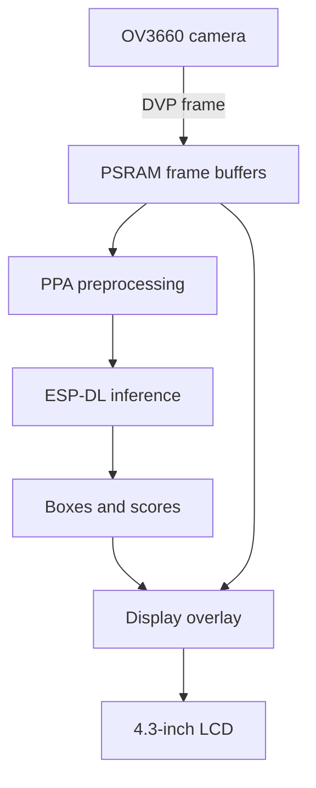

## Introduction to the ESP32-S31

The [ESP32-S31](https://www.espressif.com/en/products/socs/esp32-s31) is a high-performance system-on-chip for multimedia and AIoT applications with wireless connectivity. It combines two 32-bit RISC-V application cores, extensive wired and wireless connectivity, image and audio accelerators, and hardware security in one device.

This combination targets applications such as video doorbells, smart-home control panels, industrial automation, connected cameras, voice terminals, and appliances with rich human-machine interfaces. In this workshop, we focus on its ability to capture camera frames, run neural-network inference locally, and update a display without sending images to the cloud.

## Processing and memory

Both application cores run at up to **320 MHz**. One core has a **128-bit data path and SIMD instructions**, allowing it to process multiple small integer values in parallel. Quantized neural networks rely heavily on multiply-accumulate operations over INT8 values, so this wide path is especially useful to [ESP-DL](https://github.com/espressif/esp-dl).

The SoC also includes a 40 MHz low-power RISC-V core for work that does not require the application cores.

| Resource | ESP32-S31 capability |
|----------|----------------------|
| Application CPU | Dual-core 32-bit RISC-V, up to 320 MHz |
| Low-power CPU | 32-bit RISC-V, up to 40 MHz |
| Vector processing | 128-bit SIMD data path on one application core |
| Internal SRAM | 512 KB |
| External memory | 250 MHz, 8-bit DDR PSRAM interface |
| Memory access | Concurrent flash and PSRAM access |
| GPIO | Up to 60 programmable GPIOs |

Camera frame buffers and model activations can be much larger than internal SRAM. The ESP32-S31-Korvo-1 therefore pairs the SoC with **16 MB flash and 16 MB PSRAM**. Internal SRAM remains valuable for latency-sensitive data, while PSRAM holds large frames, display buffers, and model working memory.

## Connectivity

The ESP32-S31 integrates several protocols that would otherwise require separate chips:

- **2.4 GHz Wi-Fi 6 (802.11ax):** efficient wireless networking for connected devices
- **Bluetooth 5.4 LE:** LE Audio, Direction Finding, and Bluetooth Mesh 1.1
- **Bluetooth Classic (BR/EDR):** compatibility with established audio and HMI products
- **IEEE 802.15.4:** Thread and Zigbee, including Matter-over-Thread use cases
- **1000 Mbps Ethernet MAC:** high-bandwidth wired networking with an external PHY

Vision inference does not require a network connection, but integrated networking makes it possible to send compact events—such as "safety zone entered"—instead of raw video.

## Multimedia and new peripherals

The multimedia subsystem reduces the amount of pixel work performed by the CPU:

| Peripheral | Purpose in a vision application |
|------------|---------------------------------|
| DVP camera interface | Receives 8- or 16-bit parallel camera data |
| LCD controller | Supports 8-, 16-, and 24-bit parallel LCD output in RGB, MOTO6800, and I8080 formats |
| JPEG codec | Encodes and decodes JPEG images in hardware |
| Pixel-Processing Accelerator (PPA) | Scales, rotates, mirrors, blends, and converts images |
| 2D-DMA | Moves rectangular image regions efficiently |
| Hardware color conversion | Converts between RGB565, YUV422, YUV420, and YUV411 |

Other notable peripherals include:

- USB 2.0 High-Speed OTG and USB Serial/JTAG
- CAN FD, SDIO, UART, SPI, I2C, I2S, PARLIO, and LED PWM
- Two 12-bit SAR ADCs, two DACs, a temperature sensor, and up to 14 capacitive-touch channels
- Audio Sample Rate Converter (ASRC), CORDIC accelerator, and dual I2S controllers with hardware-level Bluetooth audio synchronization

## Edge AI capabilities

An embedded vision pipeline performs more than inference. It must capture a frame, transform it into the model's input format, run the model, decode its output, draw the result, and update the display. ESP32-S31 can distribute this work across dedicated blocks:

ESP-DL executes quantized `.espdl` models using target-optimized kernels. The SIMD core accelerates the neural-network operators, while the PPA and 2D-DMA can handle image preparation and display movement. This separation leaves more CPU time for application logic, networking, and user interaction.

Local inference offers:

- Low and predictable latency
- Operation without internet connectivity
- Reduced network bandwidth
- Better privacy because raw frames stay on the device

## Security features

Vision devices often handle sensitive images and model intellectual property. ESP32-S31 provides multiple hardware security layers:

| Feature | What it protects |
|---------|------------------|
| Secure Boot | Verifies firmware authenticity before execution |
| Flash and PSRAM encryption | Protects code, models, and runtime data stored outside the SoC |
| TRNG and RAM-based PUF | Establishes entropy and device-specific key material |
| Digital Signature peripheral | Uses a private key without exposing it to application software |
| AES-128/256, RSA, ECDSA, and ECC accelerators | Speeds up common cryptographic operations |
| Trusted Execution Environment (TEE) | Isolates trusted software from normal applications |
| Access Permission Management (APM) | Restricts access to memory and peripherals |
| Side-channel and power-glitch protections | Raises resistance to physical fault and leakage attacks |

These blocks are building blocks, not an automatic security policy. A product must still configure Secure Boot, encryption, key provisioning, update validation, and access boundaries for its threat model.

## What you learned

In this introduction, you learned that the ESP32-S31:

- Combines dual 320 MHz RISC-V cores with a 128-bit SIMD data path
- Integrates Wi-Fi 6, Bluetooth 5.4 LE and Classic, IEEE 802.15.4, and a Gigabit Ethernet MAC
- Offloads camera, display, JPEG, and pixel-processing operations to dedicated hardware
- Runs quantized computer-vision models locally with ESP-DL
- Provides hardware mechanisms for verified boot, encrypted memory, protected keys, and software isolation

## Next step

[Lecture 1: Introduction to the ESP32-S31-Korvo-1](../lecture-1)

[Return to the workshop main page](/workshops/introduction-to-esp32-s31-with-vision/)
