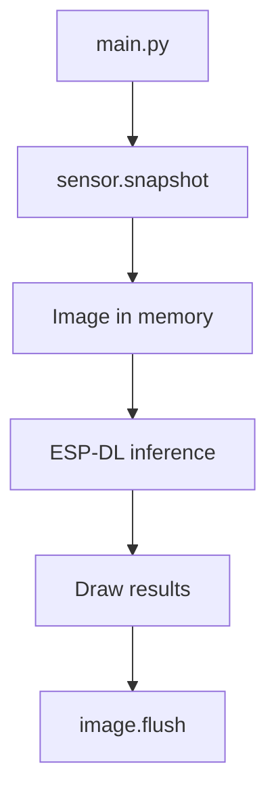

## Build vision applications fast



[ESP-Vision](https://vision.espressif.com/en) is an [open-source](https://github.com/espressif/esp-vision) rapid-development environment for camera and edge-AI applications on Espressif hardware. It combines an ESP32 build of MicroPython with high-level camera, image, display, and inference modules.

In this assignment, you will flash ESP-Vision and connect the ESP32-S31-Korvo-1 to the ESP-Vision Web IDE. The first Python application comes after the LED Blink assignment.

> [!TIP]
> The Web IDE requires no installation. It provides editing, run and stop controls, camera preview, examples, and access to device files.

## How ESP-Vision works

ESP-Vision code runs **on the SoC**, not on your computer. It uses MicroPython, a compact implementation of Python designed for microcontrollers, rather than desktop CPython. Common Python syntax is available, but the standard library is intentionally smaller and selected at firmware build time. Desktop packages, native wheels, `pip`, and operating-system services are not available on the device.

The ESP32-S31 build provides these principal modules:

| Module | Purpose |
|--------|---------|
| `sensor` | Configure the installed OV3660 or SC101IOT and capture frames |
| `image` | Draw, filter, transform, and analyze images |
| `display` | Control the board LCD |
| `espdl` | Load and execute `.espdl` models |
| `tflite` | Execute supported TensorFlow Lite Micro models |
| `imageio` | Read and write supported image sequences |

ESP-Vision also inherits a subset of MicroPython modules. The ESP32-S31 documentation indexes the following module groups:

| Group | Modules |
|-------|---------|
| Runtime | `_thread`, `asyncio`, `builtins`, `gc`, `micropython`, `platform`, `sys`, `time`, `weakref` |
| Data structures and serialization | `array`, `btree`, `collections`, `heapq`, `json`, `marshal`, `struct`, `uctypes` |
| Math and text | `cmath`, `math`, `random`, `re` |
| Binary, compression, and cryptography | `binascii`, `cryptolib`, `deflate`, `gzip`, `hashlib`, `zlib` |
| Files and streams | `errno`, `io`, `os`, `vfs` |
| Hardware and graphics | `esp`, `esp32`, `framebuf`, `machine` |
| Networking | `network`, `select`, `socket`, `ssl` |

> [!IMPORTANT]
> Module availability depends on the exact ESP-Vision firmware and board configuration. The ESP32-S31 profile disables Bluetooth, ESP-NOW, and `machine.ADC`; the workshop firmware also does not provide the `neopixel` module. Do not assume that a module available in CPython, another MicroPython port, or an online example is present here.

To see the definitive module list for the firmware currently running on your board, enter this command in the REPL:

```python
help("modules")
```

You can inspect a module's available classes and functions in the same way:

```python
import machine
help(machine)
```

The typical loop is:

<div style="display: flex; justify-content: center;">



</div>

## Why start with ESP-Vision?

ESP-Vision and MicroPython shorten the development loop compared with a native ESP-IDF application:

| Area | ESP-Vision and MicroPython | Native ESP-IDF |
|------|----------------------------|----------------|
| Development cycle | Edit and run a Python script immediately | Configure, compile, link, and flash the firmware after code changes |
| Interactive testing | Use the REPL to inspect the device and try commands one at a time | Use application logs, the serial monitor, and native debugging tools |
| Vision APIs | Access the camera, images, display, and inference through high-level modules | Select, configure, and integrate the required components |
| Model evaluation | Copy a compatible model to the device, change thresholds in Python, and quickly repeat tests | Model or configuration changes may require rebuilding and flashing the application |
| Visualization | Use the Web IDE camera preview, logs, and color histogram | Implement the required display, logging, or visualization path in the application |
| Hardware control | Use the features exposed by the firmware | Access the complete ESP-IDF API and control tasks, memory, peripherals, and performance in detail |

The REPL is particularly useful during bring-up because it lets you check an import, inspect a module, capture one frame, or read a value without creating and rebuilding a complete application.

ESP-Vision is also an effective platform for evaluating compatible models. You can replace a model file, adjust score and NMS thresholds, and observe the results with the same camera and target hardware that the final application will use. This makes it easier to compare model behavior before integrating it into a larger native ESP-IDF project.

ESP-Vision does not replace ESP-IDF. Use ESP-IDF when the application needs lower-level peripheral control, custom native components, tighter memory and task management, or production-specific system integration. Assignments 6 and 7 introduce that workflow.

Scripts and model files are separate. Models used in this workshop are stored in the root directory of the internal flash filesystem. A FAT32 microSD card mounted at `/sdcard` is only needed for models that are too large for the available flash filesystem space.

## Step 1: Flash ESP-Vision

> [!WARNING]
> The USB Type-C **UART** port is not available for the ESP-Vision development workflow. Connect the computer to the board's USB Type-A **USB CDC/JTAG/Debug** port with a data-capable USB Type-A to Type-A cable. The native USB connection is required because transferring the live camera preview over UART is too slow.

> [!IMPORTANT]
> Power supplied through the USB Type-A connection bypasses the board's power switch. Moving the switch to **OFF** does not turn the board off while the Type-A cable is connected. Disconnect the Type-A to Type-A cable to fully remove power.

1. Connect a data-capable USB Type-A to Type-A cable between your computer and the board's USB Type-A **USB CDC/JTAG/Debug** port.
2. Turn the board on.
3. Open [vision.espressif.com](https://vision.espressif.com/en) in a supported desktop browser.
4. Select **Flash It Now**.



5. Choose **ESP32-S31-Korvo-1** and the current stable ESP-Vision firmware.



6. Select **Connect Serial**.
7. Choose the USB CDC/JTAG/Debug device associated with the ESP32-S31-Korvo-1, and then select **Connect**.



8. Start flashing and wait until the operation completes. Do not disconnect or power off the board while firmware is being written.



If the browser cannot start the download, put the board into download mode:

1. Hold **Boot**.
2. Press and release **Reset**.
3. Release **Boot**.
4. Retry the web flasher.

> [!IMPORTANT]
> Flashing replaces any native ESP-IDF application currently on the board. You can restore one later with `idf.py flash`.

After ESP-Vision starts, the host computer detects the board as a removable disk. This disk exposes the files stored in the board's internal flash filesystem. You can copy scripts, models, and other application files directly to its root directory.

## Step 2: Connect to the board

Close serial monitors and other applications first; only one application can own the USB CDC/JTAG/Debug device at a time.

1. Open the **Web IDE** from [vision.espressif.com](https://vision.espressif.com/en).
2. Select **Connect**.
3. Choose the ESP32-S31-Korvo-1 USB CDC/JTAG/Debug device.



4. Stop any script that starts automatically.
5. Open the device **REPL (Read-Evaluate-Print Loop)**. The REPL is MicroPython's interactive console: it reads a command, evaluates it on the ESP32-S31, prints the result, and waits for the next command. It is useful for checking the connection, trying short API calls, and viewing script output or errors.

The connection is ready when the Web IDE reports the device as connected and the REPL displays the MicroPython prompt (`>>>`).

> [!TIP]
> The IDE camera preview is especially useful when your development board or setup does not include an LCD. It lets you inspect live camera frames directly on your computer while developing and debugging the application. The preview also includes an RGB color histogram for examining the distribution of red, green, and blue values in each frame.



## Step 3: Explore the development workflow

ESP-Vision applications normally follow this cycle:

1. **Edit** a script in the Web IDE.
2. **Save** it locally or to the device filesystem.
3. **Run** it and observe the preview and device output.
4. **Stop** it before replacing the file or opening another transport.
5. Review exceptions from the bottom upward; the final line gives the exception type and message.

Use `main.py` only when you want a script to run automatically at boot. During development, use a separate filename so a faulty infinite loop does not restart after every reset.

The Web IDE also provides access to bundled examples, the API library reference, and files on the mounted ESP-Vision flash disk.

### Common problems

| Symptom | Resolution |
|---------|------------|
| No ESP-Vision device appears | Use a data-capable USB Type-A to Type-A cable and the board's USB Type-A USB CDC/JTAG/Debug port |
| Port is busy | Disconnect the other Web IDE session, and close `idf.py monitor` or any serial terminal |
| Script cannot import a desktop package | Use only firmware modules or copy a compatible pure-Python module to `/lib` |

## What you learned

In this assignment, you:

- Used ESP-Vision on the ESP32-S31-Korvo-1
- Learned the difference between device-side MicroPython and desktop Python
- Flashed the ESP-Vision firmware through the browser
- Connected to the board with the Web IDE
- Explored the edit, run, stop, preview, example, and device-file workflow

## Next step

[Tooling: Set up the ESP-Vision MCP server](../tooling-mcp)

[Return to the workshop main page](/workshops/introduction-to-esp32-s31-with-vision/)
